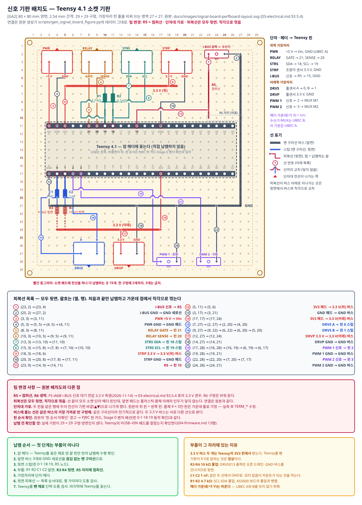

# 신호 기판 설계 — Teensy 4.1 소켓 기판

차량 로직 박스에 들어가는 **신호 기판**(Teensy를 꽂고 센서·수신기·MUX·전원·릴레이 선을 단자로 받는 만능기판)의
설계와 결정 이유를 기록한다.

- **대상 독자:** Track E 팀원, 기판을 납땜하거나 이어받을 사람
- **원본:** `docs/build/03-electrical.md` §3.5.4 ("Where it all sits on the signal board"),
  배치도 [`signal-board-perfboard-layout.svg`](../../images/signal-board-perfboard-layout.svg),
  생성기 `scripts/gen_signal_board_figure.py`. **원본과 이 문서가 다르면 원본이 기준**이고, 다른 점은 §4에 이유와 함께 적었다.
- **납땜 방법:** [신호 기판 납땜 가이드](../../02_guide/01_firmware/03_signal_board_guide.md)
- **검사 방법·결과:** [신호 기판 검증](../../03_validation/01_firmware/03_signal_board.md)
- **마지막 갱신:** 2026-11-16 · 브랜치 `firmware/steering` · 상태: 납땜 진행 중 (저항·캐패시터 완료, 다음은 Teensy 소켓)

---

## 1. 한눈에 보기

- **기판 두 장 중 정사각형이 이 기판이다.**

  | 기판 | 원본 이름 | 구멍 | 용도 | 위치 |
  |---|---|---|---|---|
  | **정사각형** | `GA2` 80 × 80 mm 양면 | **29 × 29** | **신호 기판** (이 문서) | 로직 박스 |
  | 직사각형 | `GA6` 50 × 80 mm | 18 × 29 | 릴레이 구동 기판 (전원 팀) | 전원 박스 |

- **구성:** Teensy 4.1(소켓), 3.3 V 버스 2개와 GND 버스, 풀업·필터 6개, 2단자 터미널 6개, 3핀 서보 헤더 3개, R5 점퍼선.
- **팀 그림:** `docs/02_guide/01_firmware/images/gen_signal_board_layout.py`가 **원본 생성기의 구멍 데이터를 그대로 읽어** 그린다.
  원본 배치가 바뀌면 다시 실행만 하면 따라간다. 원본의 검사(한 구멍 3개 금지 등)도 그대로 다시 돌린다.
  피복선 경로는 이 스크립트가 직각으로 찾아 그린다(§4).

## 2. 벤치에서 기판으로 — 보드 셋이 하나가 된다

`03-electrical.md` §3.5.4 표.

| 벤치 (Stage 0) | 차량 |
|---|---|
| 보드 A — Teensy | **신호 기판** (이 문서) |
| 보드 B — 홀센서 | 기판 없음. 허브 브래킷의 센서에서 1 m 케이블이 `DRVS`·`DRVP` 단자로 |
| 보드 C — AS5600 | 기판 없음. 킹핀 브래킷의 센서에서 1 m 케이블이 `STRS`·`STRP` 단자로 |
| (벤치 없음) | 릴레이 구동 기판 (전원 박스) |

- 벤치에서 쓴 풀업·필터(R1–R4, C1·C2)는 **같은 이름, 같은 값**으로 이 기판에 옮겨 온다.
- 홀센서의 100 nF 바이패스(C3·C4)는 이 기판이 아니라 **센서 브래킷 쪽**에 단다(`03-electrical.md` §3.5.4 마지막 노트).

## 3. 연결표

좌표는 **(열, 행)**, 그림 위·왼쪽의 숫자다. Teensy는 USB가 왼쪽, 위 핀 줄이 11행, 아래 핀 줄이 17행.
단자대는 팀 변경으로 **가로**(§4), 첫 번째 핀이 왼쪽이다.

| 단자·헤더 | 위치 | 핀 | Teensy | 상대편 | 선 |
|---|---|---|---|---|---|
| `PWR` | 위 (3, 3)·(5, 3) | +5 V / GND | **Vin** / GND | UBEC A 5 V | 2 |
| `RELAY` | 위 (8, 3)·(10, 3) | GATE / SENSE | **21** / **20** | 릴레이 기판 게이트 / E-stop 감지 | 2 |
| `STRS` | 위 (13, 3)·(15, 3) | SDA / SCL | **18** / **19** | AS5600 | 2 |
| `STRP` | 위 (18, 3)·(20, 3) | 3.3 V / GND | 3.3 V 버스 / GND | AS5600 전원 | 2 |
| `i-BUS 입력` | 위 (23–25, 2) | 신호 · n/c · GND | **15** (R5 점퍼 경유) / GND | 수신기 i-BUS SERVO | 2 (가운데 없음) |
| `DRVS` | 아래 (7, 27)·(9, 27) | A / B | **0** / **1** | 홀센서 OUT ×2 | 2 |
| `DRVP` | 아래 (12, 27)·(14, 27) | 3.3 V / GND | 3.3 V 버스 / GND | 홀센서 전원 | 2 |
| `PWM 1 · 조향` | 아래 (17–19, 28) | 신호 · n/c · GND | **2** / GND | MUX M1 | 2 (가운데 없음) |
| `PWM 2 · 구동` | 아래 (22–24, 28) | 신호 · n/c · GND | **3** / GND | MUX M2 | 2 (가운데 없음) |
| `IMUP` (11/16 추가) | 아래 왼쪽 (3, 26)·(3, 28), 세로 | 3.3 V / GND | 3.3 V(아래) 버스 / GND 버스 | IMU 전원 | 2 |
| `IMUS` (11/16 추가) | 아래 오른쪽 (26, 26)·(26, 28), 세로 | **SCL1 / SDA1** (납땜대로, §4) | **16** / **17** (`Wire1`) | IMU (BNO085) | 2 |

- 핀 번호의 원본은 `docs/build/04-firmware.md`의 핀 표 하나다. 벤치와 기판이 같은 표를 쓴다.
- 핀 20·21(E-stop 감지, 릴레이)은 펌웨어 E-stop 단계 전까지 쓰지 않지만 **원본대로 지금 같이 납땜**한다.
  기판을 상자에 넣은 뒤에는 고치기 어렵기 때문이다.

## 4. 원본과 다른 점과 이유

| 항목 | 원본 | 팀 | 이유 |
|---|---|---|---|
| **R5·R6** | 측정으로 정할 자리 | **R5 = 점퍼선, R6 생략** | FS-iA6B i-BUS 신호 대기 전압 **3.3 V** 측정(2026-11-14). `03-electrical.md` §3.5.4 표의 3.3 V 경우 |
| R6 구멍 | R6 자리 | **비워 둠** | 나중에 5 V 수신기로 바꾸면 분압기를 넣을 수 있게 |
| 핀 순서 | "실물로 확인 안 됨" 경고 | **확인됨** | 그림의 순서가 PJRC 핀 카드, Stage 0 벤치 배선(핀 0·1·18·19 동작)과 같다 |
| **피복선 면** | 일부 앞면, 일부 뒷면 | **모두 뒷면** | 22가닥 모두 끝이 소켓·단자·헤더 핀이다. 앞면 패드는 그 부품의 플라스틱 몸체 아래라 인두가 닿지 않는다 |
| **피복선 경로** | 두 구멍을 잇는 직선(대각선) | **구멍 줄을 따라 직각으로 꺾음** | 따라 납땜할 수 있는 실제 경로가 필요하다. 연결 관계는 원본과 같다 |
| **IMU 단자 방향** | 세로 (원본 위치) | **원본 그대로 세로** | 모서리라 옆이 곧 기판 바깥이다. 가로로 눕히면 15번 선이나 PWM 2 헤더와 겹친다 |
| **IMUS 핀 표기** (2026-11-23) | 위 (26, 26) = SDA1 → 핀 17, 아래 (26, 28) = SCL1 → 핀 16 | **위 = SCL1 → 핀 16, 아래 = SDA1 → 핀 17** | 1호 기판에서 두 선이 엇갈려 납땜됐다. 다시 납땜하지 않고 표기를 실제 구리에 맞췄다. 전기적으로 같은 버스이고, IMU 케이블을 이 표기대로 꽂으면 된다. 생성기의 `IMUS_AS_SOLDERED`로 원본 표기로 되돌릴 수 있다 |
| **IMU를 더하는 방식** | 단자 2개·선 4가닥 추가, "나머지는 움직이지 않음" | **같은 원칙: 1–22번 경로를 고정하고 23–26번만 추가** | 이미 정한 배선표가 바뀌지 않게. 생성기가 IMU 없는 그림이 이전과 바이트 단위로 같은지로 확인 |
| **SDA1·SCL1 경로** | Teensy 밑을 지나는 대각선 | **한 길로 나란히, Teensy 밑(12행)으로 들어가 핀에 아래에서 닿음** | 1–22번을 고정하면 오른쪽 위로 가는 길은 28열뿐(27열은 GND 세로선)이고, 핀 16·17 위쪽 구멍은 7번 선이 쓴다. 그래서 "Teensy 밑 금지" 규칙의 예외로 둔다 |
| **단자대 방향** | 두 핀이 같은 열(세로) — 전선이 옆으로 나감 | **두 핀이 같은 행(가로)** — 전선이 기판 바깥으로 나감 | 케이블이 가는 방향(기판 밖)으로 바로 나가게. 원본 규칙 "단자는 케이블이 가는 쪽을 향하게"(§3.5.4 납땜 순서 4). 원본의 위 핀 = 왼쪽 핀 (2026-11-14 결정) |
| **버스에 붙는 선의 끝** | 버스의 정해진 구멍 | **같은 버스의 가장 가까운 빈 구멍** | 같은 구리선이라 전기적으로 같고 선이 짧아진다. 두 3.3 V 버스는 Teensy 안에서만 이어지므로 서로 바꾸지 않는다 |
| 그림 | 영어 | 한국어 | 팀 그림은 원본 데이터를 읽어 생성(재입력 없음) |

**경로를 정한 규칙** (팀 생성기가 검사함)

- 선은 구멍 중심을 따라 가로·세로로만 가고, **양 끝에서만 납땜**한다.
- 무언가 들어 있는 구멍(핀, 부품 다리, 스텁, 다른 선의 끝) 위로 지나가지 않는다. 뒷면 부품 R3·R4 몸체도 피한다.
- **Teensy 밑(11–17행)으로는 지나가지 않는다.** 핀에는 바깥쪽에서만 들어간다. 처음에 이것을 허용했더니 핀 20으로 가는 선이
  기판 오른쪽 끝을 돌아 Teensy 밑으로 들어가는 40구멍짜리 경로가 나왔다.
- 핀 바로 바깥 구멍(진입 구멍)에서는 다른 선이 꺾지 못한다. 그 핀으로 들어갈 길이 막히기 때문이다.
- 앞면 버스, 다른 피복선과는 **직각으로 교차만** 한다(겹쳐 달리지 않고, 교차점에서 꺾지 않음).
- 결과: 22가닥, 꺾임 21곳, 선끼리 교차 10곳(단자대를 가로로 바꾼 뒤). RELAY·STRS 모서리의 교차는 피할 수 없다.
  SCL 선이 끝나는 핀 19 스텁 (10, 10)으로는 왼쪽에서만 들어갈 수 있는데, 그 왼쪽에 핀 20·21로 내려가는 선이 있기 때문이다.

- 측정 기록: [조향 벤치 검증](../../03_validation/01_firmware/02_steering_bench.md) §1.

## 5. 설계 규칙과 이유 (원본 §3.5.4에서)

| 규칙 | 이유 |
|---|---|
| **Teensy는 암 헤더에 꽂는다** | 납땜하면 Teensy가 고장 났을 때 기판째 버려야 한다(₩74,250, `order-log.md` 122행) |
| **한 구멍에 2개까지** | 소켓 핀이 이미 구멍을 차지한다. 2개는 보통 작업, 3개는 검사할 수 없는 납땜이 된다 |
| **스텁(짧은 맨 구리선)** | 핀 0·1·18·19는 여러 부품이 붙는다. 패드에서 2–3구멍 늘린 선에 하나씩 단다 |
| **버스를 건너는 부품은 뒷면** | R3·R4(10 kΩ)는 GND 버스를 건너 3.3 V로 간다. 양면 기판이라 뒷면에 단다. 필요 없는데 뒷면에 두면 나중에 인두가 닿지 않는다. (피복선은 팀 변경으로 모두 뒷면, §4) |
| **버스는 끊김 없는 맨 구리선** | 브레드보드와 달리 레일이 없다. 연결 안 된 섬이 가장 흔한 고장 |
| **부품은 담당 핀 옆** | 1 nF가 60 mm 떨어져 있으면 필터 효과가 크게 줄어든다 |
| **서보 헤더 가운데(+5 V)는 n/c** | 이 기판은 UBEC A, 수신기·MUX는 UBEC B. 이으면 두 전원이 합쳐져 "UBEC A가 죽어도 수신기·MUX는 산다"는 분리가 깨진다 |
| **3.3 V 버스는 Teensy 3V3 핀에서** | 위·아래 버스가 각자 Teensy의 3V3 핀에서 받는다. Teensy를 빼면 0 V이고 두 버스도 서로 끊긴다(정상) |
| **PWR·STRP의 GND는 Teensy GND 패드로** | 원본 배선이 그렇다: PWR GND → 패드 (4, 11), STRP GND → 패드 (17, 11), GND 버스 ← 패드 (3, 17). 세 GND는 Teensy 안에서 이어진다. Teensy를 빼고 재면 끊겨 있는 것이 정상 |
| **선은 피복선, 양 끝 납땜** | 패드 사이를 납으로 길게 잇는 방식은 진동에 갈라진다 |

## 6. 미확인 항목과 주의

- [ ] **실물 기판의 구멍 수와 양면 여부:** 29 × 29, 양면인지 센다. 다르면 배치를 다시 계산해야 한다(원본도 한 번 31로 잘못 셌다).
- [ ] **Teensy `VUSB`–`VIN` 패드 절단** (`04-firmware.md` 13행): 이 기판은 `PWR`의 5 V를 Vin에 넣는다. 자르지 않고 USB를 꽂으면
  두 전원이 맞붙어 노트북 USB로 역류한다.
  - **자르고 나면 USB만으로는 Teensy가 켜지지 않는다.** USB는 데이터만 하고, 전원은 `PWR`(벤치에서는 벤치 전원 5 V)으로 넣어야 한다.
    지금까지 벤치처럼 USB 하나로 쓰려면 이 점을 알고 자른다.
- [ ] **단자대 헤더 실측:** 그림은 몸체 핀 방향 4칸 × 폭 3칸, 핀은 폭의 가운데 줄로 가정했다. 다르면 생성기 `TERM_LEN`·`TERM_DEPTH`·`TERM_ROW`를 고쳐 다시 그린다.
- [ ] **IMU 보드 풀업 확인:** 기판에 `Wire1` 풀업이 없다. IMU 보드의 SDA1·SCL1–3.3 V가 열려 있으면 IMU 쪽에 4.7 kΩ (`04-firmware.md`, Bring up the IMU).
- [ ] **부품 보유 확인:** 24핀 암 헤더 2, 5.08 mm 2단자 터미널 6, 3핀 수 헤더 3(1×40 스트립), 4.7 kΩ 2, 10 kΩ 2, 1 nF 2 (`order-log.md` 122행).
- **PWM 헤더는 아직 벤치에서 써 보지 않았다.** 원본 경고: 처음 쓰는 순간 차가 움직일 수 있다. 드라이버 RC1·RC2를 꽂기 전에
  `pwm_effort_check`나 서보 테스터로 펄스를 먼저 확인한다(`03-electrical.md` §3.5.4). i-BUS 헤더 경로는 벤치에서 확인했다(2026-11-14).

## 7. 다음 단계

1. 위 미확인 항목 확인 → 납땜([가이드](../../02_guide/01_firmware/03_signal_board_guide.md))
2. Teensy를 뺀 채 도통·단락 검사, Teensy를 꽂고 전압 검사([검증](../../03_validation/01_firmware/03_signal_board.md))
3. 기판 위에서 Stage 0 스케치(`i2c_scan`, `as5600_check`, `quad_count`)와 `ibus_monitor`를 다시 돌려 벤치와 같은 결과인지 확인
