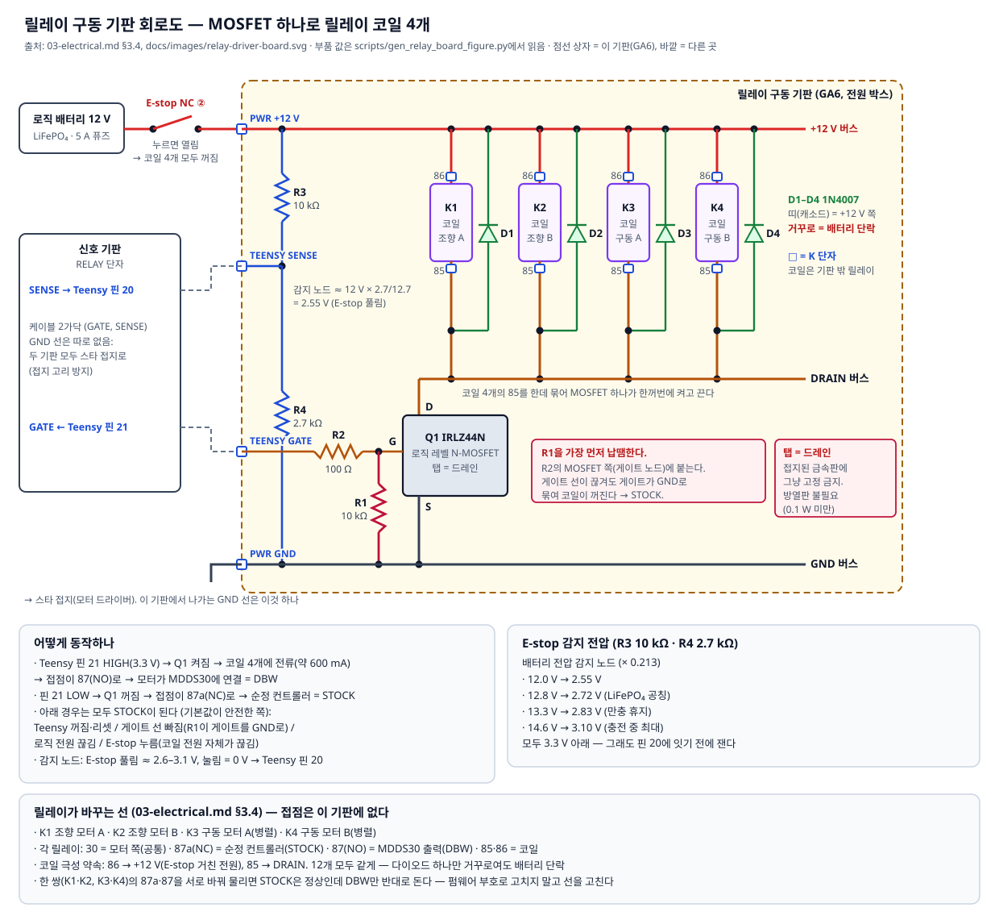

# 릴레이 구동 기판 설계 — 릴레이 MUX 코일 구동 + E-stop 감지

전원 박스에 들어가는 **릴레이 구동 기판**의 설계와 결정 이유를 기록한다. 이 기판은 Teensy의 신호 하나로 릴레이 4개를 한꺼번에 켜고 끈다.
릴레이가 켜지면 모터가 MDDS30(DBW)에, 꺼지면 순정 컨트롤러(STOCK)에 연결된다.

- **대상 독자:** Track E 팀원, 이 기판을 납땜하거나 이어받을 사람
- **원본:** `docs/build/03-electrical.md` §3.4("Wire the E-stop and MUX first"), "Where it all sits on the board", §3.7(릴레이 MUX 벤치 시험),
  회로도 [`relay-driver-board.svg`](../../images/relay-driver-board.svg), 배치도 [`relay-board-perfboard-layout.svg`](../../images/relay-board-perfboard-layout.svg),
  생성기 `scripts/gen_relay_board_figure.py`, 부품 `docs/build/01-bom-sourcing.md`(릴레이 구동 부품 표), `docs/order-log.md` #7·#12b.
  **원본과 이 문서가 다르면 원본이 기준**이고, 다른 점은 §5에 이유와 함께 적었다.
- **납땜 방법:** [릴레이 구동 기판 가이드](../../02_guide/03_relay_board/01_relay_board_guide.md)
- **검사 방법·결과:** [릴레이 구동 기판 검증](../../03_validation/03_relay_board/01_relay_board.md)
- **마지막 갱신:** 2026-11-28 · 브랜치 `firmware/estop` · 상태: 납땜 완료, 검증 1–4·6·7 통과(5는 생략)

---

## 1. 한눈에 보기

| 항목 | 내용 |
|---|---|
| 기판 | `GA6` 50 × 80 mm 양면, **29 × 18 구멍**(가장자리 한 줄을 비우면 27 × 16) — 직사각형 기판 |
| 위치 | 전원 박스 (신호 기판은 로직 박스) |
| 하는 일 | ① 릴레이 MUX 코일 4개 구동 (MOSFET 하나) ② E-stop 감지 전압을 Teensy 핀 20으로 |
| 입력 | `PWR`(E-stop을 거친 12 V, GND), `TEENSY`(GATE ← 핀 21, SENSE → 핀 20) |
| 출력 | `K1`–`K4` 코일 단자 (86, 85) → 기판 밖 릴레이 소켓 |
| 부품 | Q1 `IRLZ44N`, R1 10 kΩ, R2 100 Ω, R3 10 kΩ, R4 2.7 kΩ, D1–D4 `1N4007`, 2단자 플러그형 단자대 6개 |
| 벤치 버전 | **없다.** 코일 전류 600 mA와 게이트 풀다운을 브레드보드 접촉에 맡기지 않으려고, 회로도에서 바로 만능기판으로 간다(원본) |

## 2. 회로가 하는 일

- **릴레이 MUX:** 5핀 SPDT 릴레이 4개가 조향 모터 두 선(K1·K2)과 구동 모터 두 선(K3·K4)을 바꾼다(`03-electrical.md` §3.4 표).
  - 코일 꺼짐 = 접점 `87a`(NC) = **순정 컨트롤러 = STOCK** (기본값)
  - 코일 켜짐 = 접점 `87`(NO) = **MDDS30 = DBW**
  - 접점은 이 기판에 없다. 이 기판은 **코일만** 다룬다.
- **코일 구동:** 코일 4개의 `86`은 +12 V 버스, `85`는 DRAIN 버스로 모으고, Q1 하나가 DRAIN을 GND로 끌어내린다(로우사이드 스위치).
  Teensy 핀 21이 HIGH면 4개가 함께 켜지고 LOW면 함께 꺼진다. 네 극이 따로 놀면 한 극만 붙어 있는 위험한 상태가 생기기 때문이다.
- **E-stop:** 버튼의 두 번째 NC 접점(NC ②)이 **코일 전원(12 V) 자체**를 끊는다. 펌웨어가 무엇을 하든 코일이 꺼진다.
- **E-stop 감지:** R3·R4가 코일 전원을 나눠 Teensy 핀 20으로 보낸다. 12 V일 때 약 2.55 V, E-stop을 누르면 0 V.

## 3. 연결표

좌표는 (열, 행)이다. 배치도는 [가이드](../../02_guide/03_relay_board/01_relay_board_guide.md) §1에 있다.

| 단자 | 핀 위치 | 핀 | 연결되는 곳 |
|---|---|---|---|
| `PWR` | (2, 4)·(2, 6) | +12 V / GND | 로직 배터리 → 5 A 퓨즈 → **E-stop NC ②** → +12 V, GND → 스타 접지 |
| `TEENSY` | (2, 12)·(2, 14) | GATE / SENSE | 신호 기판 `RELAY` 단자 GATE(핀 21) / SENSE(핀 20) |
| `K1` | (7, 4)·(7, 6) | 86 / 85 | 릴레이 K1 코일 — 조향 모터 A |
| `K2` | (12, 4)·(12, 6) | 86 / 85 | 릴레이 K2 코일 — 조향 모터 B |
| `K3` | (17, 4)·(17, 6) | 86 / 85 | 릴레이 K3 코일 — 구동 모터 A |
| `K4` | (22, 4)·(22, 6) | 86 / 85 | 릴레이 K4 코일 — 구동 모터 B |

- 두 기판 사이 케이블은 **GATE, SENSE 2가닥**이다. GND 선은 따로 두지 않는다(§4의 접지 규칙).

## 4. 설계 원칙과 이유 (원본에서)

| 원칙 | 이유 |
|---|---|
| **꺼짐 = STOCK** (기본값이 안전한 쪽) | E-stop, 로직 전원 끊김, 커넥터 빠짐, Teensy 정지가 모두 순정 상태로 돌아간다. 거꾸로 배선하면 안전 분석 전체가 뒤집힌다(`safety.md`) |
| **R1 10 kΩ 풀다운은 이 기판의 MOSFET 쪽**(R2와 게이트 사이) | 게이트 선이 끊기거나 빠져도 게이트가 소스(GND)에 묶여 코일이 꺼진다. Teensy 쪽에 두면 선이 끊겼을 때 게이트가 떠서 릴레이가 STOCK과 DBW 사이에서 떨린다. 2026-11-05 원본이 회로도를 이렇게 바로잡았다 |
| **R1을 가장 먼저 납땜**하고 10 kΩ을 잰다 | 게이트가 뜬 상태의 MOSFET이 잠시도 없게 한다. 정전기에 약한 `IRLZ44N`을 만질 때도 게이트가 묶여 있다. 다른 부품이 없을 때 재야 값이 틀리면 원인이 하나뿐이다 |
| **R1의 GND는 Q1 소스 GND에서 한 칸** | 코일 전류가 풀다운과 소스 사이 구리를 지나지 않게 한다 |
| **R2 100 Ω** 직렬 | 게이트 용량(약 1.8 nF)을 충전하는 순간 전류를 제한해 Teensy 핀을 보호한다 |
| **D1–D4 `1N4007`**, 코일마다 하나, **띠는 +12 V 쪽** | 코일이 꺼질 때 튀는 전압을 12.7 V로 묶는다. 릴레이에 붙은 680 Ω만으로는 약 102 V가 걸려 MOSFET(55 V)이 망가진다. 하나라도 거꾸로면 배터리 단락 |
| **코일 극성: 86 → +12 V, 85 → DRAIN**, 12개 모두 같게 | 코일 자체는 극성이 없지만 다이오드는 있다. 릴레이마다 약속이 다르면 다이오드 하나가 거꾸로 붙는다 |
| **E-stop은 12 V 코일 전원에** | 버튼 하나로 네 코일이 함께 꺼진다. 펌웨어와 상관없다 |
| **GND 선은 이 기판에서 하나**(PWR → 스타 접지) | Teensy와 GND 선을 따로 이으면 접지 고리가 생긴다(`03-electrical.md` §3.5.3). 그 대신 생기는 전압 강하는 600 mA × 약 0.011 Ω ≈ 7 mV로, 게이트 문턱(1.0 V 이상)의 0.7 %다 |
| **Q1 탭 = 드레인** | 접지된 금속판에 그냥 고정하면 안 된다. 코일 4개 600 mA에서 0.1 W 미만이라 방열판은 필요 없다 |
| 기판이 **꽉 찼다** | 2–17행, 2–28열을 다 쓴다. 3단자 단자대를 코일 자리에 쓰면 DRAIN 버스까지 내려온다 |

## 5. 원본과 다른 점과 이유

| 항목 | 원본 | 팀 | 이유 |
|---|---|---|---|
| 부품·단자 위치 | — | **원본 그대로** | 원본의 검사(한 구멍에 다리 하나, 풀다운과 소스의 GND 한 칸 차이, 풀다운이 게이트 노드에 붙음)를 그대로 유지 |
| **피복선 면** | 대부분 앞면, TO-220 밑 2가닥만 뒷면 | **모두 뒷면** | 선 끝이 모두 단자·MOSFET 핀이나 부품 다리다. 단자의 앞면 패드는 플라스틱 몸체 아래라 인두가 닿지 않는다. 신호 기판과 같은 규칙 |
| **대각선 2가닥** | 두 구멍을 직선으로 | **직각으로 꺾음** | 게이트 → 풀다운은 (14, 14)에서, 감지 노드 → SENSE는 (3, 10)·(3, 14)에서 꺾는다. 감지선이 게이트선과 한 번 교차하는 것은 피할 수 없다(게이트 경로가 12행 전체) |
| 그림 | 영어 | 한국어 | 팀 그림은 원본 생성기의 데이터를 읽어 만든다(재입력 없음). 회로도는 기판 경계, 단자, 신호 기판과의 연결을 더해 다시 그렸다 |
| 단자대 방향 | 세로(두 핀이 같은 열) | **원본 그대로 세로** | 신호 기판은 가로로 바꿨지만 이 기판은 꽉 차 있어 가로로 눕히면 다이오드와 겹친다. PWR·TEENSY는 왼쪽 가장자리라 전선이 바깥(왼쪽)으로 나간다 |

## 6. 미확인 항목과 주의

- [ ] **실물 기판의 구멍 수:** 29 × 18인지 센다(원본은 2026-11-05에 셌다).
- [ ] **단자대 방향:** 헤더를 납땜하기 전에 플러그를 꽂아 보고 전선 구멍이 어느 쪽을 향하는지 확인한다. K1–K4는 모두 같은 쪽으로 맞춘다.
- [ ] **릴레이에 다이오드가 들어 있는지:** 몸체에 다이오드 표시가 있으면 85·86 극성이 정해져 있으므로 그 극성을 따른다(`03-electrical.md` §3.4).
- [ ] **릴레이 소켓 배선 색:** 소켓(`RV-90`)의 전선 색은 제조사마다 다르다. 멀티미터로 85·86·30·87·87a를 확인하고 소켓에 K1–K4를 매직으로 적는다.
- [ ] **감지 노드 최대 전압:** 로직 배터리 최대(LiFePO₄ 충전 중 14.6 V)에서도 3.1 V로 3.3 V 아래다. 그래도 핀 20에 잇기 전에 잰다.
- **이 기판은 처음 만든 것이 최종본이다.** 벤치 버전이 없으므로 단계마다 재고 넘어간다(가이드 §3).

## 7. 다음 단계

1. 납땜과 단계별 검사 ([가이드](../../02_guide/03_relay_board/01_relay_board_guide.md), [검증](../../03_validation/03_relay_board/01_relay_board.md))
2. 신호 기판과 케이블 연결 후 `estop_relay_check` 스케치로 게이트(핀 21)와 감지(핀 20) 확인 — **2026-11-28 통과**
   - 스케치는 `firmware/estop` 브랜치에 커밋했다(`4ac7652`, `firmware/bench/src/estop_relay_check.cpp`).
   - E-stop 버튼은 누를 때·뗄 때 1 ms 안에서 9–11번 튄다. 버튼 고장이 아니라 기계식 접점의 성질이다.
     펌웨어에 E-stop 규칙을 넣을 때 hold-off 중 LOW가 오면 hold-off를 처음부터 다시 센다([검증](../../03_validation/03_relay_board/01_relay_board.md) §7).
3. 릴레이 접점 배선(K1–K4의 30·87·87a)과 `03-electrical.md` §3.7 릴레이 MUX 벤치 시험. 전원 팀과 함께 한다.
