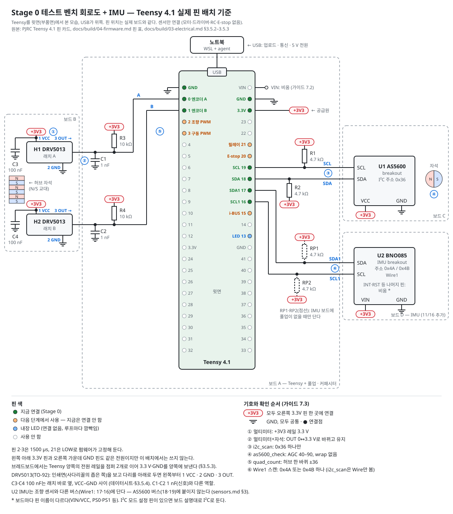

# Teensy 가이드 — MRider 조향 제어기를 이해하기 위한 기본 개념

이 문서는 마이크로컨트롤러를 처음 다루는 사람이 MRider의 Teensy 4.1 펌웨어를 **이해하고 직접 다룰 수 있도록**
쓴 개념 안내서다. 명령어 모음이 아니라, "이게 무엇이고 왜 이렇게 하는가"를 순서대로 설명한다.
설계의 원본은 `docs/design/dbw.md`, `docs/design/safety.md`, 절차의 원본은 `docs/build/04-firmware.md`이며,
이 문서와 원본이 다르면 원본이 맞다.

- 펌웨어의 실제 코드 구조, 버전, 개발 기록과 결정 이유는 개발 문서
  `docs/01_development/01_firmware/01_firmware_development.md`에 있다.
- **경로 표기:** 이 문서의 경로는 모두 **저장소 루트**(git clone한 `mrider` 폴더) 기준이다. 명령은 저장소 루트에서
  시작한다고 가정한다. `~/uros_ws`처럼 저장소 밖 경로는 공식 문서가 정한 설치 위치이며, 그때마다 출처를 적었다.

---

## 1. 큰 그림: Teensy는 무엇을 하는가

MRider는 아이용 전동차를 노트북이 운전할 수 있게 만든 차량이다. 노트북(ROS 2)은 "조향각을 몇 도로, 속도를
얼마로"라는 **목표**를 정하고, 그 목표를 실제 모터 움직임으로 바꾸는 일은 **Teensy 4.1**이라는 작은 컴퓨터가
맡는다. 이렇게 사람이 아닌 전기 신호로 조향·구동하는 구조를 **DBW(Drive-By-Wire)** 라고 한다.

```
노트북 (ROS 2)
  │  /mitt/dbw/command : "조향각 0.1 rad"            ▲  /mitt/dbw/status : "지금 0.098 rad, 상태 정상"
  ▼  (USB 케이블, micro-ROS)                          │
Teensy 4.1 ── 각도 센서(AS5600)로 실제 각도를 읽고 ─────┘
  │            목표와 비교해서 모터에 줄 힘(effort)을 계산 (1초에 200번)
  ▼  PWM 펄스 (핀 2)
신호 MUX ─▶ 모터 드라이버 MDDS30 ─▶ 조향 모터 ─▶ 바퀴가 돌아감 ─▶ 센서가 다시 읽음
```

핵심은 **피드백 루프**다. Teensy는 "모터를 3초 동안 돌려라" 같은 시간 기반 명령을 내리지 않는다. 매 순간
실제 각도를 재고, 목표와의 차이(오차)에 비례해 힘을 조절한다. 그래서 바퀴가 무겁거나 바닥이 미끄러워도 결국
목표 각도에 도달한다. 이 반복 계산을 **위치 루프(position loop)** 라고 하며, 이것이 Stage 1의 주인공이다.

---

## 2. 마이크로컨트롤러와 펌웨어

### 2.1 운영체제가 없는 컴퓨터

노트북에는 운영체제가 있어서 여러 프로그램이 번갈아 실행된다. 마이크로컨트롤러에는 그런 것이 없다. 전원이
들어오면 플래시 메모리에 저장된 **단 하나의 프로그램(펌웨어)** 이 처음부터 끝까지 혼자 실행된다. Arduino 계열
펌웨어의 뼈대는 두 함수뿐이다.

```cpp
void setup() { /* 전원이 켜질 때 한 번: 핀 설정, 센서 초기화 */ }
void loop()  { /* 그 뒤로 영원히 반복: 읽고 → 계산하고 → 출력 */ }
```

이 단순함이 장점이다. 다른 프로그램에 끼어들 틈이 없으니 "정확히 5 ms마다 계산" 같은 시간 약속을 지키기 쉽다.
반대로 `loop()` 안에서 무언가가 멈추면 **모든 것이 함께 멈춘다**. 이 약점을 막는 장치가 뒤에 나올 워치독이다.

### 2.2 펌웨어를 올리는 과정

```
PC: C++ 소스 ──컴파일──▶ firmware.hex (Teensy가 이해하는 기계어)
                                │
Teensy: [실행 모드] ──자동 전환──▶ [program 모드 = 부트로더]
                                       │  hex를 플래시에 기록
                                       ▼
                               재부팅 → 새 펌웨어 실행
```

**부트로더**는 Teensy에 따로 들어 있는 작은 프로그램으로, 새 펌웨어를 받아 플래시에 쓰는 일만 한다. USB로
연결돼 있으면 PC의 업로더가 Teensy를 자동으로 program 모드로 바꾸므로 버튼을 누를 필요가 없다. 펌웨어가
고장 나서 자동 전환이 안 될 때만 보드의 **PROGRAM 버튼**을 눌러 강제로 program 모드로 만든다.

PC에서 Teensy가 어떤 상태인지는 USB 장치 ID로 알 수 있다(`lsusb | grep 16c0`).

| USB ID | 의미 |
|---|---|
| `16c0:0483` Teensyduino Serial | 펌웨어 실행 중. `/dev/ttyACM0`(Windows에서는 COM 포트)로 통신 |
| `16c0:0478` HalfKay Bootloader | program 모드. 업로드를 기다리는 중 |

> **WSL에서 쓸 때.** WSL(윈도우 안의 리눅스)은 USB 장치를 직접 보지 못한다. Windows의 `usbipd`가 장치를
> WSL로 넘겨준다. 위의 두 상태는 USB ID가 달라 **서로 다른 장치로 취급**되므로, 두 상태 모두 한 번씩
> `usbipd bind`를 해 둬야 한다. 상태가 바뀌는 순간 다시 연결하느라 업로드 첫 시도가 실패하는 일이 잦은데,
> Teensy는 program 모드에 남아 있으므로 같은 명령을 한 번 더 실행하면 된다.

---

## 3. 핀과 전기 신호

### 3.1 핀이란

Teensy 가장자리의 금속 다리 하나하나가 **핀**이다. 펌웨어가 각 핀을 입력(전압을 읽음) 또는 출력(전압을 냄)으로
정한다. Teensy 4.1의 신호 전압은 **3.3 V**다. 5 V 신호를 그대로 넣으면 칩이 손상되므로, 다른 장치를 연결하기
전에는 그 장치의 신호 전압을 멀티미터로 먼저 잰다.

MRider가 쓰는 신호는 네 종류이고, 각각 Teensy 안의 전용 하드웨어가 처리한다. 그래서 아무 핀이나 쓸 수 없고,
핀 배치는 문서(`04-firmware.md`의 핀 표)에서 **고정(FROZEN)** 되어 있다. 브레드보드에서는 선을 옮기면 되지만
납땜한 기판에서는 다시 납땜해야 하기 때문이다.

### 3.2 PWM 서보 펄스 — 모터에 명령하기 (핀 2, 3)

모터 드라이버 MDDS30은 RC 모드에서 **서보 펄스**로 명령을 받는다. 1초에 50번(50 Hz) 짧은 HIGH 펄스를 보내고,
그 **폭**이 명령이다.

```
 1000 µs  ▕▔▏__________   전속 한 방향
 1500 µs  ▕▔▔▏_________   정지 (중립)
 2000 µs  ▕▔▔▔▏________   전속 반대 방향
          ◀──── 20 ms ────▶  (50 Hz)
```

펌웨어 내부에서는 −1 ~ +1 사이의 **effort(힘)** 로 계산하고, 마지막에 `1500 + effort × 500 µs`로 바꿔 내보낸다.
**effort 0은 정확히 1500 µs**가 되도록 만든다. 드라이버는 전원이 켜지는 순간 보이는 펄스를 "정지"로 기억하기
때문에, 중립이 조금이라도 어긋나면 그 뒤 모든 명령이 그만큼 틀어진다.

펄스는 Teensy 안의 타이머 하드웨어(FlexPWM)가 만든다. 한번 폭을 정해 두면 펌웨어가 멈춰도 **타이머는 같은 펄스를
계속 낸다**는 점을 기억해 두자. 워치독이 필요한 이유가 여기서 나온다.

### 3.3 I²C — 각도 센서 읽기 (핀 18, 19)

**AS5600**은 자석의 방향으로 각도를 재는 센서다. 회전축 끝에 자석을 붙이고 그 앞에 센서를 두면, 한 바퀴를
0 ~ 4095의 숫자(12비트)로 알려준다. Teensy는 두 가닥 선(SDA 데이터, SCL 클럭)으로 된 **I²C** 통신으로 이 값을 읽는다.

센서 숫자를 실제 각도로 바꾸는 식은 `θ = k × (raw − c0)`이다.
- **c0 (영점)**: 바퀴가 정면일 때의 raw 값. 펌웨어의 `/mitt/dbw/zero_steering` 서비스로 저장한다.
- **k (배율)**: raw 1당 몇 도인가. 좌우 끝까지 꺾어 각도계로 재서 구한다. 센서를 다는 방향에 따라 음수일 수도 있다.

두 가지를 반드시 지켜야 한다. 첫째, 센서는 **기어박스를 지난 쪽(load-side)** 에 단다. 모터 쪽에 달면 기어의
유격(backlash)만큼 바퀴 각도를 모르게 된다. 둘째, AS5600은 **한 바퀴짜리** 센서라서 4095 다음이 0이다. 조향
전체 범위 안에서 이 경계를 넘으면 각도가 갑자기 360° 튀고, 위치 루프가 엉뚱한 방향으로 모터를 민다. 그래서
Stage 0에서 끝에서 끝까지 돌려 보며 값이 끊김 없이 한 방향으로 변하는지(wrap 확인) 먼저 본다.

### 3.4 직교 엔코더 — 바퀴 회전 세기 (핀 0, 1)

구동축에는 자석과 Hall 센서 두 개(A, B)가 있어서 바퀴가 돌 때 두 개의 펄스열이 조금 어긋나게 나온다. 어느 쪽이
먼저 오는지로 **방향**을, 펄스 개수로 **회전량**을 안다. 이것을 **직교(quadrature) 엔코더**라 하고, Teensy의 전용
디코더(QDC)가 펌웨어 도움 없이 세어 준다. 속도와 주행거리(odometry) 계산에 쓰인다.

### 3.5 UART 시리얼 — RC 수신기 (핀 15)

사람이 조종하는 RC 송신기의 신호를 수신기가 받아 **i-BUS**라는 시리얼 형식(115200 bps)으로 Teensy에 넘긴다.
약 7.7 ms마다 14채널 값이 한 묶음(프레임)으로 온다. 프레임이 끊기면 "RC 신호 상실"로 판단한다. (Stage 2에서 추가)

### 3.6 단순 디지털 입출력 — E-stop 감지, 릴레이 (핀 20, 21)

핀 20은 비상정지 회로에 전기가 살아 있는지(HIGH) 읽고, 핀 21은 릴레이를 켜서 모터 제어권을 DBW 쪽으로
가져온다. 이 둘의 의미는 5장에서 설명한다. (Stage 0/3에서 추가)

### 3.7 핀 배치 요약

| 핀 | 신호 | 연결 대상 | 현재 펌웨어(Stage 0, 센싱만) |
|---|---|---|---|
| **0, 1** | 직교 엔코더 A, B | 구동축 Hall 센서 | **읽음** → 바퀴 속도·누적값 |
| 2 | PWM (조향) | 신호 MUX → MDDS30 RC1 → 조향 모터 | 항상 1500 µs (Stage 1에서 사용) |
| 3 | PWM (구동) | 신호 MUX → MDDS30 RC2 → 후륜 모터 | 항상 1500 µs (Stage 2에서 사용) |
| 15 | i-BUS (Serial3 RX) | RC 수신기 | 미사용 |
| **18, 19** | I²C SDA, SCL | AS5600 각도 센서 | **읽음** → 조향각 |
| 20 | E-stop 감지 입력 | 릴레이 보드의 분압 회로 | 미사용 |
| 21 | 릴레이 게이트 출력 | 릴레이 MUX 코일 | 항상 LOW |
| 13 | 내장 LED | 없음 (제어 주기마다 깜빡여 오실로스코프로 주기 확인) | 사용 |

> 핀 0을 엔코더가 쓰면 Serial1(RX가 핀 0)을 쓸 수 없고, 핀 20을 쓰면 Serial5(TX가 핀 20)를 쓸 수 없다.
> 그래서 i-BUS는 Serial3(핀 15)에 연결한다. 핀 하나가 여러 기능을 겸하기 때문에 생기는 제약이다.

---

## 4. 노트북과 대화하기: micro-ROS

### 4.1 왜 micro-ROS인가

노트북의 자율주행 소프트웨어는 ROS 2로 돌아간다. Teensy가 ROS 2의 **토픽**을 직접 주고받으면, 노트북 쪽에서는
Teensy가 다른 ROS 노드와 똑같이 보인다. 명령과 피드백이 **하나의 링크, 하나의 시계** 위에 있으니,
`ros2 topic echo` 하나로 양쪽을 동시에 보고 `ros2 bag`으로 한꺼번에 기록할 수 있다. 예전 설계는 명령과 피드백이
서로 다른 보드와 통신 방식으로 나뉘어 있어서 문제가 생기면 어디서 났는지 찾기 어려웠다(`dbw.md` ADR-SW1).

### 4.2 agent의 역할

Teensy는 ROS 2 전체를 돌릴 만큼 크지 않다. 그래서 **micro-ROS**는 일을 둘로 나눈다. Teensy에는 가벼운
클라이언트가, 노트북에는 **micro-ROS agent**라는 중계 프로그램이 돈다. agent가 USB 시리얼로 들어온 작은 메시지를
일반 ROS 2 토픽으로 바꿔 준다. 그래서 **agent를 켜야 Teensy의 토픽이 보인다.** agent가 없으면 Teensy는 연결을
기다리면서 제어 루프만 계속 돌린다.

### 4.3 MRider의 인터페이스

| 이름 | 방향 | 내용 | 현재 펌웨어 |
|---|---|---|---|
| `/mitt/dbw/status` (`mitt_msgs/DbwStatus`) | Teensy → 노트북 | 실제 각도, 추종 중인 목표, 속도, 엔코더 누적값, 모드, 고장 비트 | 있음 (모드는 항상 0, 목표는 0) |
| `/mitt/dbw/debug` | Teensy → 노트북 | 내부값: 센서 raw, I²C·자석 상태, c0, 워치독 리셋 여부 | 있음 |
| `/mitt/dbw/zero_steering` (서비스) | 노트북 → Teensy | 지금 각도를 영점(c0)으로 저장 | 있음 |
| `/mitt/dbw/command` (`mitt_msgs/DbwCommand`) | 노트북 → Teensy | 목표 조향각(rad), 목표 속도(m/s) | Stage 1부터 |
| 파라미터 `kp ki kd effort_max enable` | 노트북 ↔ Teensy | PID 게인과 동작 허가 | Stage 1부터 |

현재 `/mitt/dbw/debug`의 `data` 순서: 0 AS5600 raw · 1 I²C 응답(0/1) · 2 자석 정상(0/1) · 3 c0 · 4 직전 리셋이 워치독(0/1).
기능이 추가되면 뒤에 항목이 늘어난다.

`mitt_msgs`는 MRider가 직접 정의한 메시지라서 표준 micro-ROS 라이브러리에 들어 있지 않다. 그래서 라이브러리를
`mitt_msgs`를 포함해 **다시 빌드**해야 하고, 그 과정을 `firmware/mitt_dbw/scripts/build_microros_lib.sh`가 한다.
메시지 정의가 바뀌면 이 스크립트를 다시 실행해야 Teensy와 노트북이 같은 형식으로 말한다.

> **best-effort 통신.** 상태 토픽은 "받았는지 확인하지 않는" best-effort 방식으로 보낸다. 확인 응답을 기다리는
> 방식(reliable)은 응답이 늦으면 제어 루프까지 같이 멈추게 하기 때문이다. 제어기는 **절대 기다리지 않는다**가 원칙이다.

---

## 5. 안전을 만드는 개념들

조향 모터는 사람 손가락을 다치게 할 만큼 힘이 세다. MRider 설계의 많은 부분은 "무언가 고장 나도 위험하지 않게"
만드는 데 쓰인다. 펌웨어를 읽기 전에 이 원칙들을 알아 두면 코드의 이유가 보인다.

### 5.1 하드웨어가 멈추고, 펌웨어는 함부로 다시 출발하지 않는다

가장 중요한 안전 장치는 **펌웨어가 아니라 배선**이다.
- **E-stop(비상정지 버튼)** 은 평상시 닫혀 있는 접점(NC)을 통해 구동 전원과 릴레이 코일에 전기를 공급한다.
  누르면 전기가 끊겨 모터가 멈춘다. Teensy가 죽어 있어도 동작한다.
- **릴레이 MUX**는 모터를 원래 차의 제어기(STOCK)와 DBW 중 어디에 연결할지 고른다. 코일에 전기가 없으면 **STOCK**이
  기본값이라, 전원·논리 회로 어디가 고장 나도 원래 차로 돌아간다.
- **신호 MUX**는 모터 드라이버에 가는 펄스를 Teensy가 줄지, RC 수신기가 직접 줄지 고른다. Teensy가 멈춰도
  사람이 RC로 바로 조종할 수 있게 하는 장치다(Layer B).

펌웨어의 몫은 **멈춘 뒤 실수로 다시 출발하지 않게 하는 것**이다. 예를 들어 E-stop을 풀면 하드웨어는 바로 전기를
되살리지만, 펌웨어는 사람이 RC로 다시 허가(arm)하기 전까지 정지 상태를 유지한다. 핀 20의 E-stop 감지 입력은
이를 위해 있다. 이 입력은 "멈추게 하는" 장치가 아니라 "다시 출발을 신중하게 만드는" 장치다.

### 5.2 워치독 — 펌웨어가 멈췄을 때

앞에서 본 대로 펌웨어가 멈춰도 PWM 타이머는 마지막 펄스를 계속 낸다. 조향 모터에 힘을 주던 중에 멈추면 모터는
계속 돈다. **워치독**은 이를 막는 하드웨어 타이머다. 펌웨어가 주기적으로 "밥을 주지(feed)" 않으면 250 ms 뒤에
Teensy를 강제로 리셋한다. 리셋되면 펄스가 끊기고, 드라이버는 펄스가 100 ms 끊기면 모터를 세운다
(MDDS30의 DIP 스위치 `SW6 = 0` 설정일 때. 이 설정도 Stage 1에서 확인한다).

중요한 것은 **어디서 밥을 주는가**다. MRider는 "센서를 읽고 → 계산하고 → 출력한" 한 바퀴를 끝낸 직후에만 밥을
준다. 타이머 인터럽트에서 밥을 주면 메인 루프가 멈춰도 인터럽트는 계속 돌아서 워치독이 무력해진다. 그래서
제어 루프도 인터럽트가 아니라 `loop()` 안에서 시간을 재며 돌린다.

> 역으로, 정상적인 코드가 250 ms 넘게 멈추면 워치독이 리셋해 버린다. 실제로 USB는 꽂혀 있는데 agent가 꺼져 있을
> 때 micro-ROS 라이브러리의 연결 확인 함수가 최대 2초를 기다리는 바람에 리셋이 반복되는 버그가 있었고,
> 그 함수를 기다리지 않게 바꿔서 해결했다. **워치독이 있는 펌웨어에서는 어떤 함수도 오래 기다리면 안 된다.**

### 5.3 끊김 감시(staleness)

노트북 프로그램이 죽거나 USB가 빠지면 명령이 더 이상 오지 않는다. Teensy는 마지막 명령을 계속 따르는 대신,
**500 ms 동안 새 명령이 없으면** 조향을 중앙으로 돌려놓고 출력을 끊는다(`safety.md` §2 row 1).

### 5.4 센서를 믿기 전에 확인

위치 루프는 센서 값을 믿고 모터를 민다. 센서가 틀리면 엉뚱한 방향으로 힘껏 민다. 그래서 매 주기 센서 값을
검사한다. I²C 응답이 없거나, 자석이 감지되지 않거나, 각도가 물리적으로 불가능한 범위이거나, 한 주기(5 ms)에
3° 넘게 튀면 **고장**으로 보고 즉시 출력을 중립으로 둔다. 원칙은 "**나쁜 각도로는 절대 루프를 돌리지 않는다**"다.

### 5.5 기계적 한계와 stall

조향은 좌우 ±22.5°까지만 움직인다. 끝에 닿았는데 계속 밀면 기구가 상하고 모터가 과열된다. 그래서 끝 근처에서는
**중앙 쪽으로만** 힘을 줄 수 있게 막는다(limit clamp). 또 힘을 주는데도 각도가 움직이지 않는 상태(무언가 걸림,
**stall**)가 0.5초 이어지면 힘을 작게 줄인다.

### 5.6 고장 비트와 모드

Teensy는 지금 상태를 `DbwStatus`의 **mode**와 **faults**로 알린다. mode는 0 = ESTOP(정지), 1 = MANUAL_RC(사람 조종),
2 = AUTONOMOUS(노트북 명령 추종)다. faults는 여러 고장을 비트로 합친 숫자다. 예를 들어 1(각도 센서) + 2(명령 없음)
= 3이다. 화면의 숫자 하나로 "왜 안 움직이는지"를 바로 알 수 있게 하려는 것이다.

---

## 6. 위치 루프와 PID

### 6.1 오차에 반응하기

위치 루프는 매 주기 **오차 = 목표 각도 − 실제 각도**를 계산하고, 오차를 줄이는 방향으로 effort를 낸다.
가장 널리 쓰는 계산 방식이 **PID**다.

| 항 | 계산 | 하는 일 | 너무 크면 |
|---|---|---|---|
| **P** (비례) | `kp × 오차` | 오차가 클수록 세게 민다. 루프의 주된 힘 | 목표를 지나쳐 진동 |
| **D** (미분) | `−kd × 각속도` | 빨리 움직일수록 브레이크를 건다. 진동을 줄임 | 센서 잡음에 덜덜 떪 |
| **I** (적분) | `ki × 오차의 누적` | 작은 오차가 오래 남으면 조금씩 힘을 키워 마저 없앰 | 느린 큰 출렁임, 누적(windup) |

P만으로는 마찰 때문에 목표 바로 앞에서 멈추는 **정상상태 오차**가 남는 경우가 많다. I가 그 마지막 차이를 없앤다.
다만 I는 오차를 계속 더하기 때문에, 모터가 이미 최대 힘을 내는데도 더하면 값이 쌓여 나중에 크게 지나친다
(windup). 그래서 출력이 한계일 때는 더하지 않고, 누적값 자체에도 상한을 둔다.

D는 오차가 아니라 **실제 각도의 변화 속도**에 거는데, 목표가 갑자기 바뀌는 순간 D가 튀는 것(derivative kick)을
막기 위해서다. 각속도에는 잡음이 많으므로 저역통과 필터를 거친다.

마지막으로 effort는 `effort_max`를 넘지 못하게 자른다. 튜닝 초기에는 작게 두어, 게인을 잘못 넣어도 큰 힘이
나지 않게 한다.

### 6.2 튜닝 순서: P → D → I

문서는 **P부터, 그다음 D, I는 마지막에 조금만**이라고 한다(`04-firmware.md` §4.4). P를 올리며 반응이 빨라지다가
진동이 보이기 직전을 찾고, D로 진동을 누른 뒤, 그래도 남는 작은 오차만 I로 없앤다. 순서를 지키는 이유는 각 항의
효과를 따로 관찰하기 위해서다. 셋을 한꺼번에 바꾸면 무엇 때문에 좋아지거나 나빠졌는지 알 수 없다.

### 6.3 무엇을 목표로 하는가

| 측정 | 목표 |
|---|---|
| 정상상태 오차 | ≤ 1.0° |
| 천천히 왕복할 때 RMS 오차 | ≤ 1.5° |
| 10° 스텝 응답 | 90% 도달 ≤ 400 ms, 오버슈트 ≤ 15% |
| 30분 유지 시 드리프트 | ≤ 0.5° |
| 백래시(유격) | 측정해서 기록 |
| 손으로 밀었다 놓기 | 목표로 복귀 |

**≤ 1°를 끝내 못 맞추면 튜닝을 계속하지 않고 전용 모션 컨트롤러(E4)로 바꾼다**는 결정 시점이 미리 정해져 있다.
튜닝은 끝없이 할 수 있는 일이라, 숫자로 마감을 정해 둔 것이다.

---

## 7. 단계별 브링업: 왜 이 순서이고, 어떻게 하는가

부품을 한꺼번에 연결하고 켜면, 문제가 생겼을 때 원인이 배선인지 센서인지 코드인지 알 수 없다. 그래서 MRider는
**한 번에 한 가지씩 추가하고, 추가한 것을 확인한 뒤 다음으로** 간다(`safety.md` §6). 각 단계의 확인 항목(gate)을
통과해야 다음 단계로 가며, 위험한 것(모터, 바퀴 접지)일수록 뒤에 온다.

| 단계 | 연결하는 것 | 확인하는 것 | 쓰는 펌웨어 |
|---|---|---|---|
| 7.2 배선 전 | — | `VUSB`–`VIN` 분리 | — |
| 7.3 Stage 0 | 각도 센서, 엔코더 | 센서가 맞는 값을 내는가, USB가 안 끊기는가 | bench 스케치 → `mitt_dbw` |
| 7.4 Stage 1 | 조향 모터 (전류 제한 전원) | 출력 부호, 위치 루프 성능, 안전 동작 | `pwm_effort_check` → `mitt_dbw` → `mitt_dbw_hangtest` |
| 7.5 Stage 2 | RC 수신기, 구동 모터 | 두 겹의 수동 조종 | `ibus_monitor` → (펌웨어 확장) |
| 7.6 E-stop | E-stop 감지, 릴레이 | 멈춘 뒤 함부로 재출발하지 않음 | `estop_relay_check` → (펌웨어 확장) |

### 7.1 모든 단계에서 쓰는 기본 조작

이 절의 조작은 뒤의 모든 단계에서 반복해서 쓴다. 처음 한 번 천천히 익혀 두자.
명령 하나하나의 뜻(`pio`가 무엇인지, `-e`·`-t`가 무엇인지 등)은 **7.7절**에 모아 두었다.

**(1) 터미널 열기.** VS Code에서 `` Ctrl+` ``로 터미널을 연다. 프롬프트가 `사용자이름@컴퓨터이름:…$`처럼 보이면 WSL(리눅스)
터미널이다. VS Code 터미널은 열려 있는 폴더, 즉 **저장소 루트**(git clone한 `mrider` 폴더)에서 시작한다. 이 문서의 명령은 모두 이 터미널에 입력한다. 여러 프로그램을 동시에 띄워야 할 때는 터미널 오른쪽 위의
`+`로 터미널을 더 연다.

**(2) Teensy를 WSL에 붙여 두기.** 작업을 시작할 때 터미널 하나에서 아래 명령을 실행하고 **그 터미널은 그대로 둔다.**
Teensy가 재부팅하거나 program 모드로 바뀔 때마다 자동으로 다시 WSL에 붙여 준다.
```bash
"/mnt/c/Program Files/usbipd-win/usbipd.exe" attach --wsl --busid 2-3 --auto-attach
```
붙었는지는 다른 터미널에서 `lsusb | grep 16c0`으로 확인한다(2.2절의 표).
- `/mnt/c/Program Files/usbipd-win/`은 usbipd의 기본 설치 위치를 WSL에서 본 경로다. 다른 곳에 설치했다면 그 경로로 바꾼다.
- `busid 2-3`은 PC마다, 꽂은 USB 포트마다 다르다. Windows PowerShell에서 `usbipd list`로 자기 번호를 확인한다.

**(3) bench 스케치 올리기.** bench 스케치는 `firmware/bench` 폴더에 있고, `-e` 뒤에 이름을 적어 하나만 골라 올린다.
```bash
cd firmware/bench                  # 저장소 루트에서
pio run -e i2c_scan -t upload
```
마지막에 `[SUCCESS]`가 나오면 성공이다. `error writing to Teensy` 또는 `[FAILED]`가 나오면 **같은 명령을 한 번 더**
실행한다. 실행 모드에서 program 모드로 바뀌는 순간 WSL 연결이 잠깐 끊기기 때문에 첫 시도는 자주 실패하고,
Teensy는 program 모드로 기다리고 있으므로 두 번째는 대개 성공한다.

**(4) 출력 보기(시리얼 모니터).** bench 스케치는 결과를 USB 시리얼로 글자로 보낸다. 업로드가 끝나고 2~3초 뒤에:
```bash
pio device monitor
```
몇 줄마다 결과가 찍히면 정상이다. 끝낼 때는 `Ctrl+C`. 포트를 못 찾는다는 메시지가 나오면 Teensy가 아직 다시 붙지
않은 것이니 몇 초 뒤 다시 실행한다. 모니터 창에서 누른 키는 그대로 Teensy로 전달되므로, 키 입력을 받는 스케치
(`pwm_effort_check` 등)는 이 창에서 조작한다.

> **포트는 한 번에 한 프로그램만 쓸 수 있다.** 업로드하기 전, 그리고 agent를 켜기 전에는 시리얼 모니터를 끈다.
> 펌웨어(`mitt_dbw`)를 올리기 전에는 agent도 끈다(`Ctrl+C`).

**(5) 본 펌웨어와 agent.** `mitt_dbw`는 시리얼 모니터 대신 ROS 2로 대화한다.
```bash
cd firmware/mitt_dbw               # 저장소 루트에서
pio run -e mitt_dbw -t upload                         # 올리기 (실패하면 한 번 더)

# 터미널 A: agent (켜 둔다). ~/uros_ws = 04-firmware.md §4.2의 agent 설치 위치
source /opt/ros/humble/setup.bash && source ~/uros_ws/install/local_setup.bash
ros2 run micro_ros_agent micro_ros_agent serial --dev /dev/ttyACM0 -b 115200

# 터미널 B: 확인용 (새 터미널마다, 저장소 루트에서 이 source 두 줄이 필요하다)
source /opt/ros/humble/setup.bash && source ros2_ws/install/setup.bash
ros2 topic echo /mitt/dbw/status
```
agent 터미널에 `session established`가 보이면 연결된 것이다.

**(6) 막혔을 때.**

| 증상 | 원인과 해결 |
|---|---|
| 업로드 첫 시도 실패 | 정상. 한 번 더 실행 |
| auto-attach 터미널에 `Failed to attach`가 계속 반복 | usbipd가 꼬인 상태. 그 터미널에서 `Ctrl+C` 후 (2)의 명령을 다시 실행 |
| `lsusb`에 Teensy가 안 보이고 업로드도 안 됨 | PROGRAM 버튼을 한 번 누른 뒤 업로드 (강제로 program 모드) |
| Teensy가 몇 초마다 사라졌다 나타남 | 펌웨어가 재부팅을 반복하는 중. PROGRAM 버튼 → 안전한 펌웨어(`uros_echo`)를 올린 뒤 원인을 찾는다 |

### 7.2 배선 전: 전원부터 정리한다

**왜.** Teensy는 USB와 `VIN` 핀 두 곳에서 5 V를 받을 수 있고, 공장에서 나올 때는 둘이 패드로 연결돼 있다. 차량
쪽 5 V(UBEC)를 `VIN`에 넣은 채 USB를 꽂으면 노트북의 5 V와 UBEC의 5 V가 Teensy를 통해 서로 밀어붙여 노트북 포트나
Teensy가 상할 수 있다. 그래서 외부 전원을 연결하기 **전에** 이 연결을 끊는다.

**어떻게.** (`04-firmware.md` 상단 표)
1. 멀티미터를 도통(삐 소리) 모드로 두고, 보드 뒷면의 `VUSB`–`VIN` 패드 두 개를 찾는다. `5V` 핀과 삐 소리가 나는
   쪽이 `VIN`, USB 커넥터의 5 V와 삐 소리가 나는 쪽이 `VUSB`다.
2. 두 패드 사이의 얇은 연결선을 칼로 끊는다.
3. 다시 도통 검사: 두 패드 사이는 **소리가 나지 않아야** 하고, `VIN`과 `GND` 사이도 단락이 없어야 한다.

**끊은 뒤 달라지는 점.** USB는 여전히 업로드와 micro-ROS 통신을 하지만 **Teensy에 전원을 주지 못한다.** 벤치에서도
UBEC 5 V를 `VIN`에 넣어야 Teensy가 켜진다. "USB만 꽂았더니 Teensy가 죽은 것 같다"는 정상이다.

### 7.3 Stage 0: 센서만, 모터 없이

**왜.** 위치 루프는 센서 값을 믿고 모터를 민다. 센서가 틀린 채로 모터를 연결하면 루프가 그 틀린 값을 쫓아 모터를
끝까지 민다. 그래서 모터 없이 센서부터 확인한다. 이 단계에서 찾은 문제는 확실히 배선이나 센서 문제다.

**준비: 브레드보드 배선**



- **Teensy는 실제 핀 위치대로** 그렸다. 윗면(부품면)에서 본 모습이고 USB가 위쪽이다.
  - 왼쪽 열(위→아래): GND, 0–12, 3.3V, 24–32 / 오른쪽 열: VIN, GND, 3.3V, 23–13, GND, 41–33
  - 핀 색: **초록** = 지금 연결, **주황** = 다음 단계에서 쓸 핀(지금은 연결 안 함), **파랑** = 내장 LED, 흰색 = 사용 안 함
  - 엔코더(핀 0·1)는 왼쪽 열 위쪽, 각도 센서(핀 18·19)와 3.3 V 공급(오른쪽 3.3V 핀)은 오른쪽 열 위쪽에 있다.
    보드를 실제로 꽂을 때 이 위치를 그대로 찾으면 된다.
- 이 그림은 **전기적 연결**을 보여 주는 회로도다. 브레드보드의 **구멍 단위 배치**는
  `docs/images/breadboard-layout.svg`(`03-electrical.md` §3.5.3)를 본다. 그 그림은 USB가 왼쪽이라 90° 돌아가 있다.
- 그림의 ①~⑤는 아래 확인 단계 번호와 같다.
- 그림을 고치려면 `images/gen_stage0_bench_schematic.py`를 수정하고 다시 실행한다.

- **보드 A (Teensy):** 핀 0과 1에서 3.3 V 레일로 10 kΩ 하나씩, GND 레일로 1 nF 하나씩. 핀 18(SDA)과 19(SCL)에서
  3.3 V 레일로 4.7 kΩ 하나씩. 3.3 V는 Teensy의 `3V3` 핀에서 가져온다.
- **레일 브리지 두 개를 꼭 연결한다.** 브레드보드의 위쪽 레일과 아래쪽 레일은 서로 떨어져 있다. 위쪽 `+`와 아래쪽
  `+`, 위쪽 `−`와 아래쪽 `−`를 점퍼로 잇지 않으면 풀업 저항에 전원이 안 들어가 센서가 죽은 것처럼 보인다.
- **보드 B (Hall 래치 `DRV5013` 두 개):**
  - **다리 순서:** TO-92 패키지는 위에서 보면 사다리꼴이고, **글자가 인쇄된 면이 좁은 쪽**이다. 인쇄면을 나에게 두고
    다리를 아래로 하면 **왼쪽부터 1 VCC · 2 GND · 3 OUT**이다(TI 데이터시트 SLIS150N, Figure 4-2·8-3).
    VCC와 GND를 바꿔 꽂으면 부품이 망가진다.
  - **감지 면:** 인쇄면 쪽으로 다가오는 자석의 극을 감지한다(데이터시트 Figure 6-1). 자석이 인쇄면 앞을 지나가게 둔다.
  - **바이패스 커패시터:** 래치마다 **VCC–GND 사이에 100 nF**를 래치 바로 옆에 단다(데이터시트 요구,
    `03-electrical.md` §3.5.4). 핀 0·1 쪽의 1 nF(신호 잡음용)와는 역할이 다르므로 둘 다 필요하다.
  - OUT은 A가 핀 0, B가 핀 1.
- **보드 C (AS5600):** VCC는 3.3 V, GND, SDA → 핀 18, SCL → 핀 19.
- 전원을 넣기 전에 보드들의 `−` 레일끼리 도통을 확인한다. GND가 빠지면 센서가 죽은 것처럼 보인다.

이제 다섯 단계로 확인한다. **각 단계는 서로 다른 원인을 걸러 내므로 순서를 바꾸지 않는다.**

**① 전원 레일 확인 — 멀티미터.**
보드 B의 `+` 레일과 GND 사이가 **3.3 V**인지 잰다. 안 나오면 원인은 점퍼다. 센서를 의심하기 전에 고친다.

**② Hall 래치 확인 — 멀티미터와 자석.**
래치 A의 OUT과 GND 사이 전압을 재면서 자석을 지나가게 한다. 0 V ↔ 3.3 V로 **딱 바뀌고, 자석을 치워도 그대로
유지**돼야 한다. 그래서 "래치(latch)"다. 자석을 뒤집어 지나가게 하면 반대로 바뀐다. 자석을 치웠더니 저절로
돌아간다면 래치가 아니라 스위치 타입 부품이므로 엔코더 방식 전체가 성립하지 않는다. 래치 B도 똑같이 확인한다.
①과 ②는 펌웨어 없이 하는데, 이렇게 해 두면 나중에 생기는 문제를 배선 탓으로 돌릴 일이 없어진다.

**③ I²C 스캔 — `i2c_scan`.**
- **왜:** 각도가 0으로 읽힐 때 "배선이 틀려서"인지 "제대로 연결됐는데 0인지"는 겉보기에 같다. 먼저 센서가 버스에서
  대답하는지만 따로 확인한다.
- **어떻게:**
  ```bash
  cd firmware/bench                # 저장소 루트에서
  pio run -e i2c_scan -t upload
  pio device monitor
  ```
- **결과 읽기:** 2초마다 버스를 훑어 결과를 찍는다.
  - `PASS  0x36 alone.` → 통과. 다음 단계로.
  - `FAIL  nothing answered.` → 아무도 대답하지 않음. 센서를 뺀 상태에서 SDA, SCL 핀이 GND 기준 3.3 V인지 잰다.
    0 V면 풀업 저항이나 레일 브리지 문제다.
  - `FAIL  N devices` → 장치가 둘 이상. 설계는 버스당 하나다. 다른 센서 보드가 꽂혀 있거나 풀업이 두 벌인지 찾는다.

**④ 공극(air gap)과 wrap 확인 — `as5600_check`.**
- **왜:** 두 가지를 본다. 첫째, 자석과 센서 사이 거리(공극)가 적당해야 각도가 안정적이다. 둘째(안전상 더 중요),
  조향 전체 범위에서 값이 4095 → 0으로 넘어가는 지점(wrap)이 없어야 한다(3.3절).
- **어떻게:** `pio run -e as5600_check -t upload` 후 `pio device monitor`. 0.25초마다 이런 줄이 나온다.
  ```
  raw 2051   180.26 deg   AGC  63   span  812 ( 71.4 deg)   GAP OK  no wrap so far
  ```
  - `raw`, `deg`: 지금 값. `span`: 지금까지 본 최솟값~최댓값 범위.
  - `AGC`: 센서가 자석 세기를 보정하는 정도. 3.3 V 보드에서는 **40~90, 가운데 64 근처**가 목표다(5 V 기준인 128을
    노리면 안 된다). `TOO WEAK`면 자석을 가까이, `TOO STRONG`이면 멀리 한다. `GAP OK`가 나오면 **그 거리를 기록한다.**
    다른 차량도 이 값으로 조립한다.
  - 공극을 맞춘 뒤 조향축을 손으로 **끝에서 끝까지 천천히** 돌린다. 마지막 칸이 `no wrap so far`로 유지되면 통과.
    `** WRAPPED -- STOP **`이 뜨면 센서가 잘못된 축에 달린 것이다. **진행을 멈추고** 센서를 기어박스 출력 쪽(load-side)
    으로 옮긴다.
  - 조향 모터를 센서 가까이 가져가 값이 흔들리지 않는지도 본다(모터 자석의 간섭 확인).

**⑤ 엔코더 카운트 — `quad_count`.**
- **왜:** ②에서 래치 두 개가 각각 동작하는 것은 봤지만, 둘의 **간격**이 맞아야 방향을 구분할 수 있다. 앞으로
  돌리면 늘고 뒤로 돌리면 줄어드는 것이 그 첫 증거다.
- **어떻게:** `pio run -e quad_count -t upload` 후 `pio device monitor`. 0.2초마다 한 줄이 나온다.
  ```
  count      36  (+1.00 rev)  delta   +4  seen 0..36  forward
  ```
  - 자석 캐리어를 정확히 **한 바퀴** 돌리면 `count`가 **±36** 변해야 한다(자석 18개 → 9주기 × 4 엣지).
  - 반대로 한 바퀴 돌리면 **처음 값으로 돌아와야** 한다. 어긋나면 엣지를 놓친 것이다.
  - 어느 방향으로 돌려도 늘기만 하면 두 래치 간격이 틀린 것이다.
  - 차가 **앞으로 갈 때** 값이 늘어나는지 기록한다(나중에 구동 채널을 추가할 때 부호로 쓴다).

**⑥ 각도 보정(k, c0) — `mitt_dbw`.**
- **왜:** 센서의 raw 숫자를 "바퀴가 몇 도 꺾였나"로 바꾸려면 배율 k와 영점 c0가 필요하다(3.3절). 부호 약속은
  **왼쪽으로 꺾인 것이 +** 다(`calibration.md` §1, ROS 표준 REP-103).
- **어떻게:** 바퀴를 띄우고 조향 모터는 **전원 없이**(손으로 돌릴 수 있게) 둔다.
  1. `mitt_dbw`를 올리고 agent를 켠다(7.1 (5)).
  2. raw 값 보기: `ros2 topic echo /mitt/dbw/debug`에서 `data`의 첫 번째 값(0번)이 AS5600 raw다.
     1번·2번이 1이면 센서가 대답하고 자석도 정상이라는 뜻이다.
  3. 바퀴를 **왼쪽 끝**까지 돌리고, 디지털 각도계로 바퀴 각도 `θL`(약 +22.5°)과 raw `cL`을 적는다.
     **오른쪽 끝**에서 `θR`(약 −22.5°)과 `cR`을 적는다. 중간 몇 곳도 적어 두면 직선인지 확인할 수 있다.
  4. `k = (θL − θR) / (cL − cR)`을 계산해 `include/mitt_config.h`의 `kSteerDegPerCount`에 넣고 다시 빌드·업로드한다.
     음수가 나와도 그대로 넣는다(센서 방향에 따라 다르다).
  5. 바퀴를 직자 등으로 **정확히 정면**에 맞추고 영점을 저장한다. 응답에 나오는 c0 값을
     `config/calibration/steering.yaml`에도 적는다.
     ```bash
     ros2 service call /mitt/dbw/zero_steering std_srvs/srv/Trigger {}
     ```
  6. 확인: `ros2 topic echo /mitt/dbw/status`의 `steering_angle`(rad)이 각도계와 맞는지 몇 곳에서 본다.
     정면 0, 왼쪽 끝 약 +0.39, 오른쪽 끝 약 −0.39.
  7. 센서 선을 뽑아 본다. `faults`에 1이 켜지고 mode가 0인지 확인한다(고장을 제대로 잡는지).

**⑦ USB 30분 안정성.**
- **왜:** 이 USB 선이 조향 명령을 나른다. 끊기면 차가 멈춘다. 자주 끊기는 링크는 "자주 서는 차"이므로 모터를
  달기 전에 고친다.
- **어떻게:** agent를 켠 상태에서 다른 터미널에 아래를 실행하고 30분 기다린다.
  ```bash
  timeout 1800 ros2 topic hz /mitt/dbw/status > dbw_hz.log 2>&1    # 현재 폴더에 기록
  ```
  기록에 `average rate`가 계속 200 근처로 찍히고, agent 터미널에 연결이 끊겼다 다시 맺어진 흔적이 없어야 한다
  (목표: 30분 동안 끊김 0회). 끊기면 케이블, USB 포트, usbipd 순으로 의심한다.

**Stage 0 gate:** wrap 없음 · k와 c0 측정·기록 · 센서를 뽑으면 고장 비트 · 30분 끊김 0회 · 엔코더 방향 확인.

### 7.4 Stage 1: 조향 모터, 전류 제한 전원으로

> **현재 저장소의 펌웨어는 Stage 0(센싱만)이다.** 이 절에서 쓰는 `mitt_dbw`의 기능(명령 추종, `enable`·게인
> 파라미터, effort·P/I/D 디버그 값, `mitt_dbw_hangtest`)은 Stage 1을 시작할 때 펌웨어에 추가한다.
> 아래 설명은 그 기능이 들어온 뒤의 사용법이다. debug 값의 번호도 그때 기준이다.

**왜.** 처음 루프를 닫을 때는 게인이 틀리거나 부호가 반대일 수 있다. **전류를 제한한 실험용 전원**을 쓰면 루프가
폭주해도 모터가 힘없이 웅웅거리는 정도로 끝난다. 구동 모터와 바퀴 접지는 아직 하지 않는다.

**준비: 배선과 설정**
- 실험용 전원의 **전류 제한을 낮게**, 모터가 무부하로 겨우 돌 정도로 맞춘다. 이 전원이 MDDS30의 모터 전원이다.
- **MDDS30 DIP 스위치** (`03-electrical.md` §3.5): `SW1 SW2 = 0 0`(RC 입력) · `SW3 SW4 = 1 1`(두 채널 독립.
  `0 0`이면 두 모터가 섞여 조향 명령이 구동 모터를 돌린다) · `SW5 = 0` · `SW6 = 0`(전원 켤 때 중립 학습, 신호 100 ms
  끊기면 정지) · `SW7 SW8 = 1 0`.
- 신호: Teensy 핀 2 → 신호 MUX의 master 입력 → MDDS30 `RC1`. 모터 Left 출력 → 조향 모터. MUX가 Teensy(master)
  쪽을 고르고 있는지 확인한다(`03-electrical.md` §3.5.1).
- **켜는 순서:** Teensy 먼저(1500 µs를 내기 시작) → MUX → 마지막에 모터 드라이버. 드라이버는 켜질 때 들어오는
  펄스를 정지로 학습하므로, 그 순간 1500 µs가 들어가 있어야 한다.

**① 출력 부호 — `pwm_effort_check` (루프를 닫기 전에 반드시).**
- **왜:** "+effort를 주면 각도가 커진다"는 약속이 맞아야 PID가 오차를 줄인다. 반대면 오차를 키우는 방향으로 밀어
  조향이 끝까지 꺾인다. 그래서 튜닝보다 먼저 한다.
- **어떻게:** 저장소 루트에서 `cd firmware/bench`, `pio run -e pwm_effort_check -t upload`, `pio device monitor`.
  모니터 창에서 키를 누른다.

  | 키 | 동작 |
  |---|---|
  | `1` `2` `3` | +0.05 / +0.10 / +0.15 effort를 1초 동안 |
  | `4` `5` `6` | −0.05 / −0.10 / −0.15 effort를 1초 동안 |
  | `0` 또는 스페이스 | 즉시 중립 |
  | `f` | PWM 주기 변경 (중립일 때만) |
  | `H` (대문자) | hang 테스트 |

  `2`를 누르면 1초 뒤 `raw moved +N counts = +X deg`와 함께 결론이 찍힌다. `+effort -> +angle : kSteerEffortSign = +1`
  이면 그대로, `-1`이라고 나오면 `firmware/mitt_dbw/include/mitt_config.h`의 `kSteerEffortSign`을 `-1.0f`로 바꾼다.
  `barely moved`가 나오면 effort가 너무 작거나 전원이 없는 것이니 `3`으로 다시 해 본다.
  이 스케치 안의 `kSteerDegPerCount`가 ⑥에서 정한 값과 같아야 부호 판단이 맞다(스케치 46번째 줄).

**② PWM 주기 — 같은 스케치의 `f` 키.**
중립 상태에서 `f`를 누를 때마다 50 → 100 → 200 → 300 Hz로 바뀐다. 각 주기에서 `2`, `5`를 눌러 모터가 여전히
따라오는지 본다. 드라이버가 따라오는 최고 주기를 기록한다(문서상 아직 미정인 값). 확인 전까지 펌웨어는 50 Hz다.

**③ 신호 끊김 시 정지 — 같은 스케치.**
`3`처럼 effort를 주는 1초 사이에 Teensy의 **PROGRAM 버튼**을 누른다. 펌웨어가 멈추며 펄스가 끊기고, 모터는
**100 ms 안에 서야** 한다(`SW6 = 0`). 계속 돌면 DIP 스위치를 다시 확인한다. 다시 쓰려면 스케치를 다시 올린다.

**④ 위치 루프 튜닝 — `mitt_dbw`.**
- **준비:** ①에서 정한 부호, ⑥에서 정한 k가 `mitt_config.h`에 들어간 상태로 `mitt_dbw`를 빌드·업로드하고 agent를 켠다.
- **명령 보내기 — rqt_publisher.** 새 터미널에서 (source 두 줄 후) `ros2 run rqt_publisher rqt_publisher`.
  창에서 Topic에 `/mitt/dbw/command`, Type에 `mitt_msgs/msg/DbwCommand`, Freq에 `50`을 넣고 `+`로 추가한 뒤
  왼쪽 체크박스를 켜면 50 Hz로 계속 보낸다. 목표 각도는 `steering_angle`의 Expression 칸을 고쳐 바꾼다
  (라디안: 5° = `0.0873`, 10° = `0.1745`, 20° = `0.3491`). 계속 보내는 중에 값만 바꾸므로 명령이 끊기지 않는다.
- **허가와 게인 — 또 다른 터미널.**
  ```bash
  ros2 param set /mitt_dbw effort_max 0.3     # 처음엔 작게
  ros2 param set /mitt_dbw kp 1.0             # P부터, 작게
  ros2 param set /mitt_dbw enable true        # 거부되면: 센서 고장 또는 명령이 안 오는 중
  ```
- **그래프 보기:** `ros2 run rqt_plot rqt_plot /mitt/dbw/status/steering_angle /mitt/dbw/status/steering_setpoint`
- **튜닝 진행 (6.2절의 순서):**
  1. 목표를 0 ↔ 10°로 바꿔 가며 `kp`를 조금씩 올린다(`1.0` → `1.5` → `2.0` …). 반응이 빨라지다가 목표를 지나쳐
     흔들리기 시작하면 그 직전 값으로 돌아간다.
  2. `kd`를 `0.02`처럼 작게 넣어 흔들림이 줄어드는지 본다. 너무 크면 모터가 덜덜 떤다.
  3. 목표에 1° 넘게 못 미치고 멈추면 `ki`를 작게(`0.2` 등) 넣는다.
  4. 출력이 한계에 붙어 있는지는 `ros2 topic echo /mitt/dbw/debug`의 0번 값(effort)이 `effort_max`와 같은지로 본다.
     붙어 있으면 `effort_max`를 조금 올린다.
- **측정 기록:** 6.3절 여섯 가지를 측정할 때는 `ros2 bag record /mitt/dbw/status /mitt/dbw/debug /mitt/dbw/command`로
  원자료를 남긴다(멈출 때 `Ctrl+C`). 스텝 응답은 10°짜리 목표 변경을, 왕복 RMS는 천천히 ±20°를 오가는 명령을 쓴다.
- **멈추기:** `ros2 param set /mitt_dbw enable false` 또는 rqt_publisher의 체크박스 끄기 → 중앙 복귀 후 정지.
- **마무리:** 찾은 게인을 `mitt_config.h`의 `kSteerKpDefault` 등에 옮겨 적는다. 파라미터는 재부팅하면 사라진다.

**⑤ 안전 동작 확인 — `mitt_dbw`.** 각 동작이 실제로 일어나는지 눈과 숫자로 본다.

| 시험 | 하는 법 | 기대 결과 |
|---|---|---|
| 한계 클램프 | 목표를 `0.40`(한계 밖)으로 | 약 21.5°에서 멈춤, `faults`에 4, 바깥쪽 힘 없음 |
| stall | TRACKING 중 조향 암을 손으로 잡아 막기 | 0.5초 안에 `faults`에 8, debug 0번 값이 ±0.15 이하로 줄어듦 |
| 명령 끊김 | rqt_publisher 체크박스 끄기 | 0.5초 안에 mode 0, 중앙 복귀 후 debug 6번 값이 1500 |
| 센서 고장 | TRACKING 중 AS5600 선 뽑기 | 즉시 mode 0, `faults`에 1, 펄스 1500 |

**⑥ hang 테스트 — 워치독이 실제로 동작하는가.**
- **왜:** 리셋(③)은 펄스를 끊지만 hang(펌웨어 멈춤)은 펄스가 계속 나온다. 이 상황을 끝내는 것은 워치독뿐이다.
  한 번도 시험하지 않은 워치독은 없는 것과 같다.
- **간단한 방법:** `pwm_effort_check`에서 `H`. +0.10 effort를 준 뒤 일부러 멈춘다. 모터가 **약 350 ms(250 + 100)
  안에** 서야 한다. 계속 돌면 워치독이 설정되지 않은 것이다.
- **본 펌웨어로:** `pio run -e mitt_dbw_hangtest -t upload` 후 TRACKING에서 목표를 크게 바꿔 모터가 도는 중에
  `ros2 topic pub --once /mitt/dbw/hang_test std_msgs/msg/Empty {}`. 모터가 서고 Teensy가 재부팅된다. 재연결 후
  debug 8번 값이 1이면 워치독 리셋이었다는 뜻이다. **시험이 끝나면 반드시 `mitt_dbw`를 다시 올린다.**
- 측정한 시간과 워치독 설정(250 ms)을 함께 기록한다.

**Stage 1 gate:** 6.3절 여섯 가지 측정 기록 · 신호 끊김 정지 확인(③) · 클램프·stall·끊김 확인(⑤) · hang 테스트(⑥) ·
E4 전환 여부 결정과 기록. 이것이 Week 11 (11/23) Merge 1의 내용이다.

### 7.5 Stage 2: RC 수신기, 구동 모터, 두 겹의 수동 조종

**왜.** 자율주행 중 문제가 생기면 사람이 즉시 조종을 넘겨받아야 한다. **Layer A**는 RC 신호를 Teensy가 받아 "각도
명령"으로 바꾸는 방식이라 조종감이 좋지만 Teensy가 살아 있어야 한다. **Layer B**는 신호 MUX가 RC 수신기를
드라이버에 직접 연결하는 방식이라 Teensy가 죽어도 동작한다. 한 칩이 모든 것을 맡는 설계가 허용된 조건이 바로
Layer B이므로, **Teensy를 일부러 멈춘 상태에서** 시험한다.

**어떻게 (준비 단계):**
1. **전압부터 잰다.** 수신기(FS-iA6B)는 5 V로 동작하고 Teensy는 5 V를 못 견딘다. 수신기의 i-BUS 출력이 쉬고 있을
   때의 전압을 잰다. 3.3 V 근처면 그대로, 5 V 근처면 분압 저항을 넣는다(`03-electrical.md` §3.5.4). 그다음에 핀 15에 연결.
2. `pio run -e ibus_monitor -t upload` 후 `pio device monitor`. 확인할 것: 프레임이 초당 약 130개 들어오는가, 체크섬
   오류가 없는가, 채널 배치(CH1 조향, CH2 스로틀, CH5 MUX 선택, CH6 KILL/MANUAL/AUTO)가 맞는가.
3. **송신기를 꺼 본다.** `NO FRAMES`가 뜨면 펌웨어가 신호 상실을 잡을 수 있다. 프레임이 계속 들어오면 수신기가
   failsafe 값을 보내는 중이므로, 송신기에서 **CH6의 failsafe를 KILL로** 설정하고 다시 시험한다.
4. 이후 펌웨어에 RC 해석과 구동 채널을 추가하고(이전 전체 버전 `mitt_dbw_firmware.patch` 참고),
   `04-firmware.md` §4.5의 Layer A/B 시험을 한다.

### 7.6 E-stop 감지와 릴레이

**왜.** 5.1절의 "다시 출발하지 않기"를 구현하려면 펌웨어가 E-stop이 눌렸는지 알아야 한다. 또 E-stop을 풀면 모터
드라이버가 새로 켜지면서 그 순간의 펄스를 정지로 학습하므로, 버튼이 눌린 동안과 풀린 직후 일정 시간(hold-off, 1초부터
시작)은 펄스를 정확히 1500 µs로 유지해야 한다.

**어떻게 (준비 단계):**
1. `pio run -e estop_relay_check -t upload` 후 `pio device monitor`. 상태 줄에 `sense HIGH/LOW`, `gate`, 전환 횟수,
   튐(bounce) 횟수가 나온다.
2. 버튼을 놓은 상태에서 `sense HIGH`, 누르면 `LOW`, **감지 선을 뽑아도 `LOW`** 인지 확인한다(선이 끊겨도 "정지"로
   읽혀야 안전하다). 한 번 누를 때 전환이 한 번만 세어져야 한다.
3. 모니터에서 `g`를 누르면 릴레이가 DBW 쪽으로 붙고(딸깍), `x`를 누르면 STOCK으로 돌아간다. E-stop을 누르면 `g`가
   거부되고 릴레이가 떨어져야 한다. 전원을 다시 켰을 때 릴레이는 STOCK이어야 한다.
4. 이후 펌웨어에 감지·hold-off·재허가 규칙을 추가한다.

이후 단계(벤치 failsafe 시험, 지면 주행)는 `docs/build/06-bench-test.md`, `07-manual-drive.md`를 따른다.

### 7.7 이 장에서 쓰는 명령어

#### PlatformIO와 `pio`

**PlatformIO**는 마이크로컨트롤러용 빌드 도구다. Teensy 펌웨어를 만들려면 ARM용 컴파일러, Teensy 코어 라이브러리
(Arduino 호환 함수들), 업로더, 시리얼 모니터가 필요한데, PlatformIO가 이것들을 **자동으로 내려받고 버전을 고정해서**
관리한다. Arduino IDE가 버튼으로 하는 일(컴파일, 업로드, 시리얼 모니터)을 터미널 명령으로 한다고 보면 된다.
**`pio`** 는 그 명령줄 프로그램의 이름이다.

PlatformIO는 **현재 폴더의 `platformio.ini`** 를 읽어서 무엇을 어떻게 빌드할지 정한다. 그래서 `pio` 명령은 항상
`platformio.ini`가 있는 폴더(`firmware/bench` 또는 `firmware/mitt_dbw`)로 `cd`한 뒤에 실행한다.

```ini
[env]                          ; 모든 환경에 공통인 설정
platform = teensy@6.0.0        ; Teensy 개발 도구 묶음의 버전 (고정해서 언제 빌드해도 같은 결과)
board = teensy41               ; 보드 종류
framework = arduino            ; setup()/loop() 방식의 Arduino 호환 코드
upload_protocol = teensy-cli   ; 명령줄 업로더 사용
monitor_speed = 115200         ; 시리얼 모니터 속도

[env:i2c_scan]                 ; "i2c_scan"이라는 환경 = 빌드 단위 하나
build_src_filter = +<i2c_scan.cpp>   ; 이 환경은 이 파일 하나만 컴파일한다
```

**환경(env)** 은 "어떤 소스로 어떤 펌웨어를 만들지"의 단위다. `firmware/bench`는 스케치마다 환경이 하나씩 있고,
`firmware/mitt_dbw`에는 `mitt_dbw`(본 펌웨어)와 `uros_echo`(통신 테스트) 두 개가 있다. 명령의 `-e` 뒤에 이 이름을 쓴다.

PlatformIO가 받아 둔 도구는 `~/.platformio/`에, 빌드 결과물은 각 프로젝트의 `.pio/` 폴더에 생긴다. `.pio/`는
언제든 다시 만들 수 있으므로 git에 올리지 않는다(`firmware/.gitignore`).

| 명령 | 하는 일 |
|---|---|
| `pio run` | 빌드만 한다. `-e`를 안 주면 기본 환경(`default_envs`), 없으면 모든 환경을 빌드 |
| `pio run -e i2c_scan` | `i2c_scan` 환경만 빌드 |
| `pio run -e i2c_scan -t upload` | 빌드한 뒤 Teensy에 올린다. `-t`(target)는 "빌드 다음에 할 일" |
| `pio run -e i2c_scan -t clean` | 그 환경의 빌드 결과를 지운다. 이상하게 빌드될 때 처음부터 다시 하려고 쓴다 |
| `pio device list` | PC에 연결된 시리얼 포트 목록. Teensy는 `/dev/ttyACM0`로 보인다 |
| `pio device monitor` | 시리얼 모니터. Teensy가 `Serial.print`로 보낸 글자를 보여 주고, 누른 키를 Teensy로 보낸다. 속도는 `platformio.ini`의 `monitor_speed`. 끝낼 때 `Ctrl+C` |
| `pio run -e … -t upload -t monitor` | 업로드 후 바로 모니터. WSL에서는 업로드 직후 포트가 늦게 붙어 실패하기 쉬워서 이 문서는 두 명령을 따로 쓴다 |
| `pio --version` | 설치된 PlatformIO 버전 |

#### Linux / WSL 기본 명령

| 명령 | 뜻 |
|---|---|
| `cd firmware/bench` | 폴더 이동. 경로가 `/`나 `~`로 시작하지 않으면 **지금 폴더 기준**(상대 경로)이다. 이 문서는 저장소 루트에서 시작한다고 가정한다. `~`는 내 홈 폴더(`/home/사용자이름`), `cd ..`는 한 단계 위로 |
| `lsusb` | 연결된 USB 장치 목록 |
| `lsusb \| grep 16c0` | `\|`(파이프)는 앞 명령의 출력을 뒤 명령에 넘긴다. `grep 16c0`은 그중 `16c0`(Teensy 제조사 번호)이 든 줄만 보여 준다 |
| `./test/host/run_host_tests.sh` | 이 폴더 안의 스크립트를 실행. `./`는 "현재 폴더의" |
| `timeout 1800 명령` | 명령을 1800초(30분) 뒤 자동으로 끝낸다 |
| `명령 > 파일 2>&1` | 화면에 나올 출력(오류 포함)을 파일에 저장 |
| `Ctrl+C` | 지금 터미널에서 돌고 있는 프로그램을 멈춘다 |

#### usbipd (Windows의 USB를 WSL로 넘기기)

| 명령 | 어디서 | 뜻 |
|---|---|---|
| `usbipd list` | Windows PowerShell | USB 장치와 busid(포트 번호), 공유 상태 |
| `usbipd bind --busid 2-3` | Windows PowerShell (**관리자**) | 이 장치를 WSL과 공유하도록 허용. 장치 상태(실행/program 모드)마다 처음 한 번 |
| `"/mnt/c/Program Files/usbipd-win/usbipd.exe" attach --wsl --busid 2-3 --auto-attach` | WSL | 장치를 WSL에 붙이고, 재부팅으로 떨어질 때마다 다시 붙인다. 켜 둔 채로 작업 |

#### ROS 2 명령

| 명령 | 뜻 |
|---|---|
| `source /opt/ros/humble/setup.bash` | 이 터미널에서 `ros2` 명령을 쓸 수 있게 환경을 설정. **새 터미널마다** 해야 한다 |
| `source ~/uros_ws/install/local_setup.bash` | micro-ROS agent를 쓸 수 있게 추가 설정. `~/uros_ws`는 `docs/build/04-firmware.md` §4.2가 agent를 설치하는 위치다(다른 곳에 설치했다면 그 경로) |
| `source ros2_ws/install/setup.bash` (저장소 루트에서) | `mitt_msgs` 메시지 형식을 알게 하는 설정. 이게 없으면 `/mitt/dbw/status`를 읽지 못한다 |
| `ros2 run micro_ros_agent micro_ros_agent serial --dev /dev/ttyACM0 -b 115200` | agent 실행. `ros2 run <패키지> <프로그램>` 형식이고, 뒤는 "시리얼 포트 `/dev/ttyACM0`로 Teensy와 통신"이라는 뜻 |
| `ros2 topic list` | 지금 있는 토픽 목록. `/mitt/dbw/status`가 보이면 Teensy가 연결된 것 |
| `ros2 topic echo /mitt/dbw/status` | 토픽 내용을 계속 출력. `--once`를 붙이면 한 번만 |
| `ros2 topic hz /mitt/dbw/status` | 토픽이 초당 몇 번 오는지 측정 |
| `ros2 service call /mitt/dbw/zero_steering std_srvs/srv/Trigger {}` | 서비스 호출: `<서비스 이름> <형식> <요청 내용>`. Trigger는 내용 없는 요청이라 `{}` |
| `ros2 param set /mitt_dbw kp 2.0` | (Stage 1부터) `mitt_dbw` 노드의 파라미터 값 변경. `get`, `list`도 있다 |
| `ros2 bag record 토픽들` | 토픽을 파일로 녹화. `Ctrl+C`로 멈추면 폴더가 생긴다 |
| `ros2 run rqt_publisher rqt_publisher` | 메시지를 일정 주기로 보내는 창 프로그램 |
| `ros2 run rqt_plot rqt_plot 토픽/필드` | 값을 실시간 그래프로 그리는 창 프로그램 |

#### 저장소 스크립트

| 명령 | 뜻 |
|---|---|
| `./test/host/run_host_tests.sh` (`firmware/mitt_dbw`에서) | 판단 코드를 PC에서 컴파일해 단위 테스트 실행. `N passed, 0 failed`면 통과 |
| `./scripts/build_microros_lib.sh` (`firmware/mitt_dbw`에서) | micro-ROS 라이브러리를 Docker로 다시 만든다. 새 PC에서 처음, 또는 `mitt_msgs`가 바뀌었을 때 (약 5분) |

---

## 8. 펌웨어 코드 구조

펌웨어는 **단계마다 기능을 하나씩 더하며** 자란다. 지금은 Stage 0(센싱만)이고, 각 단계가 끝날 때마다 git 커밋으로
남긴다. 파일은 역할별로 나뉘어 있고, "판단하는 코드"와 "핀을 만지는 코드"를 분리한 것이 핵심이다.

| 파일 | 역할 | 지금 |
|---|---|---|
| `include/mitt_config.h` | 모든 숫자(핀, 주기, 보정값, 한계값)를 한곳에. 태그로 출처 표시: `[FROZEN]` 문서 고정, `[SPEC]` 설계값, `[MEASURE]` 측정해서 채울 값, `[POLICY]` 팀 확정 필요 (Stage 1부터 `[TUNE]` 튜닝값 추가) | 센싱용 값 |
| `src/sensors.*` | **판단만 하는 코드**: 각도를 믿어도 되는지(타당성 검사), 엔코더 → 속도. Arduino에 의존하지 않아 PC에서 테스트 가능 | 있음 |
| `src/hal.*` | **핀만 만지는 코드**: 센서 읽기, 펄스 출력(지금은 1500 µs 고정), 워치독 | 있음 |
| `src/uros_node.*` | micro-ROS: 토픽, 서비스, 재연결 | 있음 |
| `src/calibration.*` | 영점 c0를 EEPROM에 저장해 재부팅 후에도 유지 | 있음 |
| `src/main.cpp` | 위 부품을 묶는 200 Hz 루프 | 있음 |
| `test/host/` | PC에서 돌리는 단위 테스트 | 센서 판단 21개 |
| (Stage 1) 조향 판단 코드 | 모드, PID, 한계·stall·끊김 규칙 | 추가 예정 |
| (Stage 2) 구동 판단 코드 | 속도 제한, 가감속 제한 | 추가 예정 |

루프는 5 ms(200 Hz)마다 다음을 반복한다. 기능이 늘어도 이 뼈대는 그대로이고, 2·3번 단계만 채워진다.

```
1. 읽기   : 각도 센서, 엔코더 (Stage 1부터 명령·파라미터도)
2. 판단   : 센서를 믿을 수 있나? (Stage 1부터 PID → effort)
3. 쓰기   : (Stage 1부터) effort → 펄스 폭 → 핀 2, 3
4. 확인   : 여기까지 왔다는 증거로 워치독에 밥 주기
```

판단 코드를 핀에서 분리해 두면, 센서나 모터를 연결하기 전에 "자석이 빠지면 바로 고장으로 잡는가", "각도가 한 번에
튀면 믿지 않는가" 같은 규칙을 PC에서 여러 상황으로 시험할 수 있다(`./test/host/run_host_tests.sh`).
하드웨어에서 처음 발견하면 위험한 실수를 책상 위에서 먼저 잡는 것이다.

---

## 9. 개발 환경과 코드 관리

### 9.1 빌드 도구

- **PlatformIO**: 컴파일·업로드 도구. `platformio.ini`에 보드와 플랫폼 버전(`teensy@6.0.0`)이 고정되어 있다.
  버전을 고정하는 이유는 같은 코드가 다음 학기에도 같은 결과를 내도록 하기 위해서다(`software.md` §6.3).
- **micro-ROS 라이브러리**: `scripts/build_microros_lib.sh`가 Docker로 만든다. 결과물은 빌드 산출물이라 git에
  올리지 않고, 무엇으로 만들었는지는 `BUILD_INFO.txt`에 기록된다.

### 9.2 git과 협업

- `origin`(교수님 저장소 `jrkwon/mrider`)은 학생에게 읽기 전용이다. 업데이트를 받는 용도로만 쓴다.
- 팀 코드는 팀이 함께 쓰는 **fork**에 올리고, 작업은 `main`이 아닌 브랜치(예: `firmware/sensing`)에서 한다.
  `main`은 교수님 원본과 똑같이 두고, 교수님 업데이트를 받는 용도로만 쓴다.
  팀 코드가 본 저장소에 들어가는 방식(PR 등)은 교수님/조교에게 확인한다.
- **단계마다 커밋한다.** 측정 기록에는 그때 쓴 펌웨어의 커밋 번호를 적어야 하므로(`06-bench-test.md`),
  측정하기 전에 커밋해 둔다.
- 빌드 산출물(`.pio/`, `.host_build/`, `lib/micro_ros_arduino/`)은 `firmware/.gitignore`로 제외되어 있다.

---

## 10. 용어 정리

| 용어 | 뜻 |
|---|---|
| DBW (Drive-By-Wire) | 기계적 연결 대신 전기 신호로 조향·구동하는 방식 |
| 펌웨어 | 마이크로컨트롤러에 저장되어 실행되는 프로그램 |
| 부트로더 / program 모드 | 새 펌웨어를 받아 플래시에 쓰는 내장 프로그램 / 그 상태 |
| PWM 서보 펄스 | 펄스 폭(1000–2000 µs)으로 명령을 전하는 신호. 1500 µs = 정지 |
| effort | 펌웨어 내부의 모터 힘 명령, −1 ~ +1 |
| I²C | 두 선으로 센서와 통신하는 방식 |
| 직교 엔코더 | 어긋난 두 펄스로 회전 방향과 양을 재는 센서 |
| i-BUS | FlySky RC 수신기의 시리얼 출력 형식 |
| micro-ROS / agent | 마이크로컨트롤러용 ROS 2 / 이를 노트북의 ROS 2와 이어주는 중계 프로그램 |
| 위치 루프 | 목표와 실제 각도의 차이로 모터 힘을 계속 고치는 제어 |
| PID | 비례·적분·미분 세 항으로 제어 출력을 계산하는 방법 |
| windup | 적분항이 한계 상태에서 계속 쌓여 생기는 큰 지나침 |
| 워치독 | 펌웨어가 멈추면 칩을 리셋하는 하드웨어 타이머 |
| staleness | 명령이 일정 시간 새로 오지 않은 상태 |
| stall | 힘을 주는데 움직이지 않는 상태 |
| E-stop | 비상정지 버튼. 하드웨어적으로 전원을 끊는다 |
| 릴레이 MUX / 신호 MUX | 모터를 STOCK/DBW 중 어디에 연결할지 / 드라이버 펄스를 Teensy/수신기 중 누가 줄지 고르는 장치 |
| gate | 다음 단계로 가기 전에 통과해야 하는 확인 항목 |

---

## 부록: 자주 쓰는 명령

```bash
# Teensy를 WSL에 연결 유지 (Windows 쪽 usbipd, 켜둔 채로 작업)
"/mnt/c/Program Files/usbipd-win/usbipd.exe" attach --wsl --busid 2-3 --auto-attach

# 경로는 모두 저장소 루트 기준
cd firmware/mitt_dbw
pio run -e mitt_dbw -t upload        # 빌드 + 업로드 (agent는 먼저 끈다. 첫 시도가 실패하면 한 번 더)
./test/host/run_host_tests.sh        # PC 단위 테스트
./scripts/build_microros_lib.sh      # micro-ROS 라이브러리 재생성 (새 PC, 메시지 변경 시)

# 노트북 쪽 mitt_msgs (최초 1회, 저장소 루트에서)
cd ros2_ws && source /opt/ros/humble/setup.bash && colcon build --packages-select mitt_msgs

# agent와 확인 (~/uros_ws = 04-firmware.md §4.2의 agent 설치 위치)
source /opt/ros/humble/setup.bash && source ~/uros_ws/install/local_setup.bash
ros2 run micro_ros_agent micro_ros_agent serial --dev /dev/ttyACM0 -b 115200
ros2 topic hz /mitt/dbw/status       # 다른 터미널 (ros2_ws/install/setup.bash 를 source)
ros2 service call /mitt/dbw/zero_steering std_srvs/srv/Trigger {}
```
