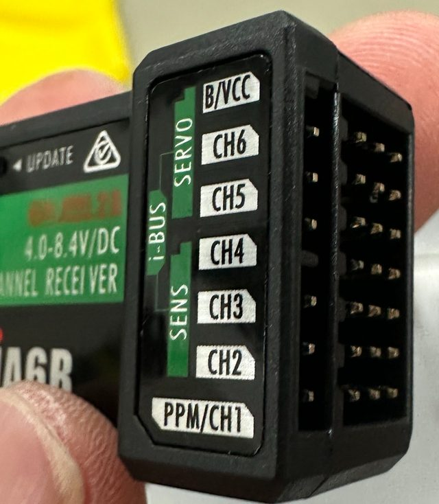
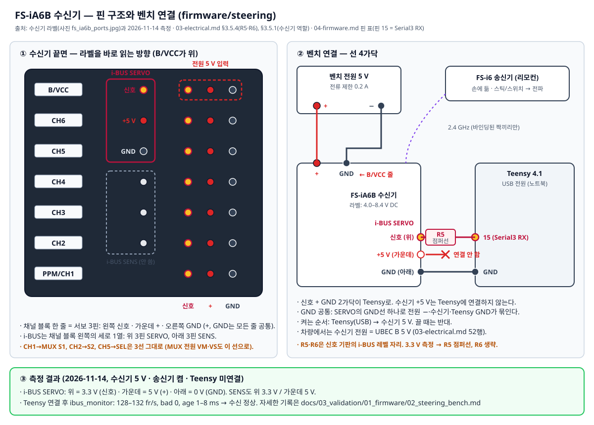

# RC 수신기 가이드 — FS-iA6B 핀 구조, 연결, 확인

RC 송신기·수신기가 무엇이고, 수신기를 Teensy에 어떻게 연결해 확인하는지 설명한다.

- **대상 독자:** RC 수신기를 처음 Teensy에 연결하는 사람
- **측정 결과:** [조향 벤치 검증](../../03_validation/01_firmware/02_steering_bench.md)
- **결정 이유(R5·R6 등):** [조향 설계](../../01_development/01_firmware/02_steering_design.md) §6.2
- **원본:** `docs/build/03-electrical.md` §3.5.1(수신기 역할), §3.5.4(R5·R6), `docs/build/04-firmware.md` 핀 표·§4.5

---

## 1. 송신기와 수신기

| | **FS-i6** | **FS-iA6B** |
|---|---|---|
| 역할 | **송신기(리모컨)** — 스틱·스위치 위치를 2.4 GHz 전파로 보낸다 | **수신기** — 전파를 받아 채널 신호로 내보낸다 |
| 위치 | 안전 담당자가 손에 든다 | 차에 고정 |
| 전원 | 자체 건전지 | 5 V (차량: UBEC B, 벤치: 벤치 전원) |

- **바인딩:** 송신기와 수신기는 짝을 맺어야(바인딩) 통신한다. 같은 상자의 세트끼리 쓴다(3세트 보유, `docs/order-log.md` 10행).
- **iA6B여야 한다:** 이름이 비슷한 FS-iA6에는 i-BUS 포트가 없다(`docs/build/01-bom-sourcing.md` 204행).

## 2. 수신기가 하는 세 가지 일

`docs/build/03-electrical.md` §3.5.1 표.

| 수신기 출력 | 연결 | 역할 |
|---|---|---|
| **i-BUS** (시리얼, 14채널) | Teensy **핀 15** | Layer A — Teensy가 스틱을 조향 **각도**로 바꿔 위치 루프로 따라감 |
| **CH1·CH2** 서보 펄스 | 신호 MUX **S1·S2** | Layer B — Teensy를 거치지 않는 비상 경로 |
| **CH5** 서보 펄스 | 신호 MUX **SEL** | 두 경로 중 어느 쪽을 드라이버로 보낼지 하드웨어로 선택 |

## 3. 핀 구조





그림 생성: `docs/02_guide/01_firmware/images/gen_receiver_wiring.py` (사용법은 파일 맨 위)

**라벨을 바로 읽는 방향(B/VCC가 위)** 으로 놓고 본다.

- **채널 블록(오른쪽):** 한 줄이 서보 커넥터 하나(3핀)다. 줄 이름은 위에서부터 B/VCC, CH6, CH5, CH4, CH3, CH2, PPM/CH1.
  - 한 줄의 3핀 = **왼쪽 신호 · 가운데 + · 오른쪽 GND**
  - **+끼리, GND끼리는 모든 줄이 수신기 안에서 연결**되어 있다. 그래서 어느 줄로 전원을 넣어도 된다. 채널을 비워 두려고 B/VCC 줄을 쓴다.
- **i-BUS 열(채널 블록 왼쪽에 따로 있는 세로 1열):** 라벨의 초록 괄호가 위치를 알려 준다.
  - 위 3핀 = **i-BUS SERVO** → Teensy에 연결하는 포트. 위에서부터 **신호 · + · GND**
  - 아래 3핀 = i-BUS SENS → 텔레메트리 센서용. 쓰지 않는다.
- **서보 커넥터 규칙:** 3핀 커넥터의 **가운데는 항상 +** 다. 가운데 핀을 재면 전원 전압(5 V)이 나오므로 신호로 착각하지 않는다.

> [!TIP]
> 핀 역할은 **전원을 끈 상태의 도통 테스트**로 확인한다. 같은 열의 서로 다른 두 줄을 찍었을 때
> 삐 소리가 나면 + 열이나 GND 열이고, 안 나면 신호 열이다. 둘 중 가운데가 +다.

## 4. 연결 — 어떤 선을 몇 가닥 연결하나

| 연결 | 선 | 이유 |
|---|---|---|
| 전원 → 수신기 B/VCC | **+5 V, GND** | 수신기 전원. 라벨 정격 4.0–8.4 V |
| 수신기 i-BUS SERVO → Teensy | **신호 → 핀 15, GND → GND** (+ 연결 안 함) | Teensy는 UBEC A, 수신기는 UBEC B. +를 이으면 두 전원이 합쳐진다(§3.5.4) |
| 수신기 CH1·CH2·CH5 → MUX S1·S2·SEL | **3선 그대로** | 수신기와 MUX는 같은 UBEC B. MUX 전원(VM·VS)도 이 선으로 들어간다 |
| Teensy 핀 2·3 → MUX M1·M2 | **신호, GND** | 신호 기판 헤더의 가운데(+)는 연결하지 않음(n/c) |
| MUX OUT1·OUT2 → MDDS30 RC1·RC2 | **신호, GND** (빨간 선 빼기) | MDDS30 RC 헤더의 가운데는 드라이버 자체 5 V가 나오는 핀으로 본다(`03-electrical.md` §3.5.1 경고, 그림에서 추론한 것) |

- **GND는 반드시 공유한다.** 신호는 GND 기준 전압이다. GND가 이어지지 않으면 Teensy가 신호를 읽지 못하고 프레임이 안 들어오거나 `bad`가 늘어난다.
- **+는 공유하지 않는다.** 서로 다른 전원(UBEC A와 B)끼리 출력이 맞붙지 않게 하기 위해서다.
- **켜는 순서(벤치):** Teensy(USB) → 수신기 5 V. 끌 때는 반대. Teensy가 꺼진 상태에서 3.3 V 신호가 핀으로 들어가지 않게 한다.

## 5. i-BUS 신호 전압 — 왜 먼저 재나

- Teensy 4.1은 **5 V를 견디지 못한다.** 수신기는 5 V로 동작하므로 i-BUS 신호가 몇 V로 나오는지 **핀 15에 꽂기 전에** 잰다.
- 결과에 따라 신호 기판의 R5·R6이 정해진다. 3.3 V면 R5 = 점퍼선·R6 생략, 5 V면 R5·R6 분압(`03-electrical.md` §3.5.4).
- **우리 측정: 3.3 V → R5 점퍼선, R6 생략.** 방법과 기록은 [검증 문서 §1](../../03_validation/01_firmware/02_steering_bench.md).
- 멀티미터는 평균값을 보여 준다. 프레임이 오가는 동안에는 대기 전압보다 약간 낮게 읽힌다.

## 6. 처음 켤 때 — LED와 바인딩

| 수신기 LED | 뜻 |
|---|---|
| 계속 켜짐 | 송신기와 연결됨 |
| 깜빡임 | 송신기 신호를 못 잡음 |
| 빠르게 깜빡임 | 바인딩 모드 |

**깜빡이면 아래 순서로 확인한다.**

1. **송신기 시작 경고:** FS-i6은 켤 때 스위치(SwA–SwD)가 모두 위, **왼쪽 스틱(스로틀)이 맨 아래**가 아니면 경고를 띄우고 전파를 보내지 않는다.
2. **같은 세트인지:** 리모컨과 수신기가 같은 상자에서 나온 짝인지 본다.
3. **바인딩** (FlySky 설명서 기준 — 공식 문서에는 "Bind the RC set"만 있다, `04-firmware.md` §4.5)
   1. 수신기 전원을 끄고, 전원을 안 쓰는 줄(CH3·CH4)의 +·GND로 옮긴다.
   2. B/VCC 줄에 **바인드 플러그**(신호 핀과 GND만 잇는 3핀 점퍼)를 꽂는다. 없으면 암-암 점퍼선으로 신호–GND만 잇는다. **가운데 +는 절대 잇지 않는다.**
   3. 수신기 전원을 켠다 → LED 빠르게 깜빡임.
   4. 송신기 **BIND KEY를 누른 채** 전원을 켠다.
   5. 끝나면 플러그를 빼고 송신기 → 수신기 순서로 껐다 켠다. LED가 계속 켜지면 성공.

## 7. `ibus_monitor`로 확인

```bash
cd firmware/bench
pio run -e ibus_monitor -t upload     # 첫 시도가 실패하면 한 번 더
pio device monitor                    # 업로드 후 10~15초 기다린 뒤
```

250 ms마다 한 줄이 나온다. **송신기가 꺼져 있어도 줄은 나와야 한다.**

```
CH1 1500 CH2 1499 CH3 1009 CH4 1499 CH5 1727 CH6 2000 | 132.0 fr/s bad 0 | steer +0.00 thr -0.00 CH6=AUTO CH5 HIGH | age 1 ms OK
```

| 항목 | 뜻 | 정상 |
|---|---|---|
| `CH1`–`CH6` | 채널 값(µs) | 1000–2000, 가운데 1500 |
| `fr/s` | 초당 받은 프레임 | 약 130 |
| `bad` | 체크섬 오류 누적 | 0, 늘지 않음 |
| `steer`, `thr` | CH1·CH2를 −1~+1로 바꾼 값 | 스틱 따라 변함 |
| `CH6=`, `CH5` | 스케치에 임시로 넣은 모드 해석([POLICY]) | 채널 배치가 정해진 뒤 의미가 있음 |
| `age` | 마지막 프레임 이후 시간 | 100 ms 미만이면 `OK` |
| `NO FRAMES YET` | 프레임을 한 번도 못 받음 | 송신기를 켜면 사라져야 함 |

- **CH5·CH6이 중간값(예: 1727)이면** 스위치가 아니라 다이얼(VrA·VrB)에 연결된 기본 설정이다. MUX SEL은 2단 스위치여야 하므로
  송신기 메뉴 **Functions setup → Aux. channels**에서 스위치로 바꾼다(조향 설계 D1).
- **송신기를 꺼 본다:** `NO FRAMES`가 뜨면 펌웨어가 끊김 시간으로 RC 상실을 잡을 수 있다. 값이 계속 오면 failsafe 값을 보내는 것이므로
  송신기의 모드 채널 failsafe를 KILL로 설정한다(조향 설계 D2).

## 8. 막혔을 때

| 증상 | 원인 | 조치 |
|---|---|---|
| 모니터에 아무 줄도 안 나옴 | USB 시리얼 상태 이상, 다른 프로그램이 포트 사용 | 다른 모니터를 닫고 **USB를 뽑았다 다시 꽂는다** |
| `NO FRAMES YET` 계속 | 송신기 꺼짐·미연결(LED 깜빡임) | 6절 |
| LED는 켜졌는데 `NO FRAMES` | 신호선이 14번(TX)에, SENS 포트에, GND 미연결 | 핀 **15**, **SERVO 위 핀**, GND선 확인 |
| 〃 | 송신기 출력이 S.BUS | 송신기 System → RX setup → Output mode에서 **i-BUS** |
| `bad`가 계속 늘어남 | 전압 레벨이나 GND 문제 | GND선, 신호 전압 다시 확인 |
| 가운데 핀이 5 V로 측정됨 | 가운데는 + 전원 | 신호는 SERVO **위 핀** |
