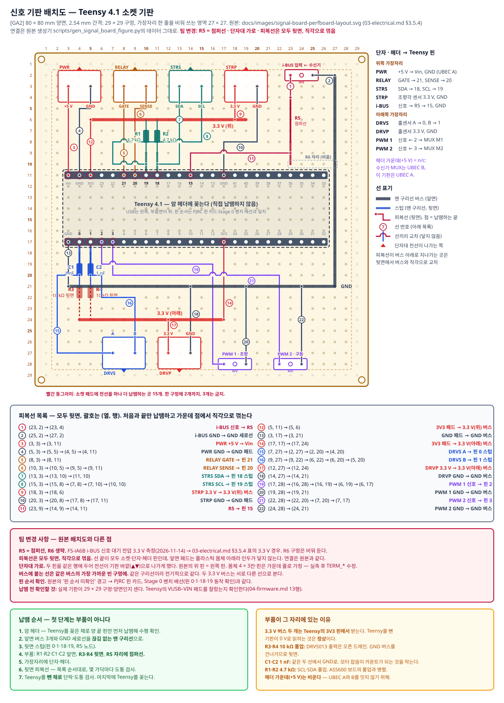
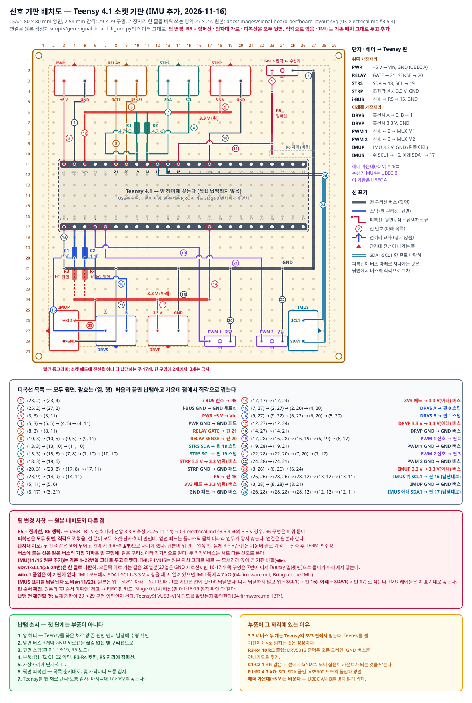

# 신호 기판 납땜 가이드 — Teensy 4.1 소켓 기판

정사각형 만능기판(GA2 80 × 80, 29 × 29 구멍)에 신호 기판을 납땜하는 순서와 방법.

- **대상 독자:** 만능기판 납땜을 처음 하는 사람
- **설계와 결정 이유:** [신호 기판 설계](../../01_development/01_firmware/03_signal_board_design.md) (연결표, 규칙의 이유, 미확인 항목)
- **검사:** [신호 기판 검증](../../03_validation/01_firmware/03_signal_board.md)
- **원본:** `docs/build/03-electrical.md` §3.5.4

---

## 1. 배치도 읽는 법

그림 생성: `docs/02_guide/01_firmware/images/gen_signal_board_layout.py` (사용법은 파일 맨 위)

- **그림은 두 장이다.** 위 그림은 IMU가 들어오기 전의 기판(1–22번 선)이고, IMU를 더한 그림은 §3.7에 있다.
  두 그림에서 1–22번은 **같은 경로**다. IMU 그림은 위 그림에 단자 2개와 선 4가닥(23–26번)만 더한 것이다.

- **좌표 (열, 행):** 그림 위쪽 숫자가 열, 왼쪽 숫자가 행이다. 이 문서의 좌표도 같은 방식이다.
- **방향:** 부품면(앞면)을 위로, Teensy의 **USB가 왼쪽**. 가장자리 한 줄은 비워 둔다(점선 테두리 안쪽만 사용).
- **선 모양**

  | 그림 | 실제 |
  |---|---|
  | 굵은 선 | 맨 구리선 버스, **앞면** |
  | 중간 굵기 선(핀 0·1·18·19 옆, R5 노드) | 스텁: 패드에 납땜한 2–3구멍 길이의 맨 구리선, **뒷면** |
  | 가는 선 + 번호 | 피복선, **모두 뒷면**. 양 끝의 점만 납땜하고, 꺾인 곳은 그 구멍 위에서 직각으로 구부린다 |
  | 반원(⌒) | 피복선끼리 교차(서로 닿지 않고 위로 넘어감) |
  | 피복선이 버스 아래로 지나감 | 뒷면에서 앞면 버스와 직각으로 교차 |
  | 연한 점선 부품(R3·R4) | 부품을 **뒷면**에 단다 |
  | 빨간 동그라미 | 소켓 패드에 전선을 하나 더 납땜하는 곳 |
  | 속 빈 원 `n/c` | 헤더 가운데(+5 V), 아무 데도 연결하지 않음 |
  | 단자대 옆 ▲▼ | 단자대 전선이 나가는 쪽(기판 바깥) |

- **피복선이 모두 뒷면인 이유:** 선 끝이 전부 소켓·단자·헤더 핀이다. 앞면 패드는 그 부품의 플라스틱 몸체 아래라
  인두가 닿지 않으므로, 핀이 튀어나온 뒷면에서 핀에 붙인다. 원본 배치도는 일부를 앞면으로 그렸지만 연결은 같다
  ([설계 §4](../../01_development/01_firmware/03_signal_board_design.md)).
- **보는 방향 주의:** 그림은 **앞면에서 본** 모습이다. 뒤집어서 납땜할 때는 **좌우(열 번호)가 반대**로 보인다.
  기판 가장자리에 5열마다 매직으로 열 번호를 적어 두면 헷갈리지 않는다.

## 2. 준비물

| 부품 | 수량 | 비고 |
|---|---|---|
| 24핀 암 헤더 | 2 | Teensy 소켓 |
| 5.08 mm 2단자 터미널 블록 | 6 | PWR, RELAY, STRS, STRP, DRVS, DRVP |
| 3핀 수 헤더 | 3 | 1×40 스트립에서 잘라서. i-BUS, PWM 1, PWM 2 |
| 4.7 kΩ | 2 | R1(SCL), R2(SDA) |
| 10 kΩ | 2 | R3(A), R4(B) — 뒷면 |
| 1 nF | 2 | C1(A), C2(B) |
| 맨 구리선, 피복 단선 | 적당량 | 버스·스텁·R5 점퍼선 / 신호선 |

공구: 인두, 납, 니퍼, 핀셋, 멀티미터(도통 모드).

## 3. 납땜 순서

**순서가 중요하다.** 첫 단계는 부품이 아니라 소켓이고, Teensy는 마지막에 꽂는다.

### 3.1 암 헤더 (소켓)

1. 24핀 암 헤더 두 줄을 **11행과 17행, 3–26열**에 꽂는다.
2. **Teensy를 헤더에 꽂은 채로** 기판을 뒤집는다. 헤더가 직각으로 고정된다.
3. 각 줄의 **양 끝 핀 하나씩만** 먼저 납땜하고, 기판에 평평하게 붙었는지 본다.
4. 괜찮으면 나머지 핀을 납땜하고 **Teensy를 뺀다.** 이후 단계에서는 Teensy를 꽂지 않는다.

### 3.2 버스와 스텁 (맨 구리선)

| 이름 | 위치 | 비고 |
|---|---|---|
| 3.3 V (위) | 6행, 5–19열 | |
| GND | 21행, 3–27열 | |
| 3.3 V (아래) | 24행, 4–17열 | |
| GND 세로선 | 27열, 2–21행 | 서보 헤더용 |
| 스텁 핀 0 · 핀 1 | 4열 · 5열, 17–20행 | 소켓 패드에서 시작 |
| 스텁 핀 19 · 핀 18 | 10열 · 11열, 9–11행 | 소켓 패드에서 시작 |
| i-BUS 노드 | 23열, 8–10행 | Teensy 패드 아님 |

- 버스는 **한 가닥으로 끊김 없이** 구멍마다 납땜한다. 끊긴 섬이 가장 흔한 고장이다.
- 버스는 **앞면**, 스텁은 **뒷면**(소켓 패드가 뒷면에서만 닿으므로).
- 버스에 전원을 넣어 주는 짧은 선 3개(3V3·GND 패드 → 버스)는 피복선 목록 12–14번이다. 3.4에서 다른 선과 함께 단다.

### 3.3 부품

| 부품 | 값 | 구멍 | 면 |
|---|---|---|---|
| R1 | 4.7 kΩ | (10, 9) – (10, 6) | 앞 |
| R2 | 4.7 kΩ | (11, 9) – (11, 6) | 앞 |
| C1 | 1 nF | (4, 18) – (4, 21) | 앞 |
| C2 | 1 nF | (5, 18) – (5, 21) | 앞 |
| R3 | 10 kΩ | (4, 19) – (4, 24) | **뒷면** (GND 버스를 건넘) |
| R4 | 10 kΩ | (5, 19) – (5, 24) | **뒷면** |
| **R5** | **점퍼선** | (23, 4) – (23, 8) | 앞 |
| R6 | 비움 | (23, 10) – (27, 10) | — |

### 3.4 단자·헤더와 신호선

먼저 가장자리에 단자와 헤더를 납땜한다.

**단자대는 가로로 놓는다**(팀 변경, [설계 §4](../../01_development/01_firmware/03_signal_board_design.md)).
두 핀이 같은 행에 두 칸 간격으로 들어가고, 플러그의 전선 구멍이 **기판 바깥(위쪽 단자는 위, 아래쪽 단자는 아래)** 을 향한다.

| 단자·헤더 | 왼쪽 핀 | 오른쪽 핀 |
|---|---|---|
| `PWR` | (3, 3) +5 V | (5, 3) GND |
| `RELAY` | (8, 3) GATE | (10, 3) SENSE |
| `STRS` | (13, 3) SDA | (15, 3) SCL |
| `STRP` | (18, 3) 3.3 V | (20, 3) GND |
| `DRVS` | (7, 27) A | (9, 27) B |
| `DRVP` | (12, 27) 3.3 V | (14, 27) GND |
| i-BUS 헤더 | (23, 2) 신호 · (24, 2) n/c · (25, 2) GND | |
| PWM 1 헤더 | (17, 28) 신호 · (18, 28) n/c · (19, 28) GND | |
| PWM 2 헤더 | (22, 28) 신호 · (23, 28) n/c · (24, 28) GND | |

- **납땜 전에 헤더를 끼워서 확인한다.** 그림은 몸체를 핀 방향 4칸 × 폭 3칸, 핀은 폭의 가운데 줄로 **가정**했다.
  핀이 몸체의 한쪽 끝 줄에 있거나 몸체가 더 크면 알려 달라(생성기의 `TERM_*` 값만 바꿔 다시 그린다).
- 핀이 구멍에 빡빡하면 적당히 눌러 끝까지 넣고, 너무 굵으면 그 구멍만 1.2 mm로 넓힌다. 억지로 밀어 넣지 않는다.

그다음 피복선을 **뒷면**에서 단다. 괄호는 (열, 행)이고, 처음과 끝만 납땜하며 가운데 점에서 직각으로 꺾는다.

| # | 경로 (꺾는 점) | 역할 |
|---|---|---|
| 1 | (23, 2) → (23, 4) | i-BUS 신호 → R5 |
| 2 | (25, 2) → (27, 2) | i-BUS GND → GND 세로선 |
| 3 | (3, 3) → (3, 11) | PWR +5 V → Vin |
| 4 | (5, 3) → (5, 5) → (4, 5) → (4, 11) | PWR GND → GND 패드 |
| 5 | (8, 3) → (8, 11) | RELAY GATE → 핀 21 |
| 6 | (10, 3) → (10, 5) → (9, 5) → (9, 11) | RELAY SENSE → 핀 20 |
| 7 | (13, 3) → (13, 10) → (11, 10) | STRS SDA → 핀 18 스텁 |
| 8 | (15, 3) → (15, 8) → (7, 8) → (7, 10) → (10, 10) | STRS SCL → 핀 19 스텁 |
| 9 | (18, 3) → (18, 6) | STRP 3.3 V → 3.3 V(위) 버스 |
| 10 | (20, 3) → (20, 8) → (17, 8) → (17, 11) | STRP GND → GND 패드 |
| 11 | (23, 9) → (14, 9) → (14, 11) | R5 → 핀 15 |
| 12 | (5, 11) → (5, 6) | 3V3 패드 → 3.3 V(위) 버스 |
| 13 | (3, 17) → (3, 21) | GND 패드 → GND 버스 |
| 14 | (17, 17) → (17, 24) | 3V3 패드 → 3.3 V(아래) 버스 |
| 15 | (7, 27) → (2, 27) → (2, 20) → (4, 20) | DRVS A → 핀 0 스텁 |
| 16 | (9, 27) → (9, 22) → (6, 22) → (6, 20) → (5, 20) | DRVS B → 핀 1 스텁 |
| 17 | (12, 27) → (12, 24) | DRVP 3.3 V → 3.3 V(아래) 버스 |
| 18 | (14, 27) → (14, 21) | DRVP GND → GND 버스 |
| 19 | (17, 28) → (16, 28) → (16, 19) → (6, 19) → (6, 17) | PWM 1 신호 → 핀 2 |
| 20 | (19, 28) → (19, 21) | PWM 1 GND → GND 버스 |
| 21 | (22, 28) → (22, 20) → (7, 20) → (7, 17) | PWM 2 신호 → 핀 3 |
| 22 | (24, 28) → (24, 21) | PWM 2 GND → GND 버스 |

- 헤더 가운데 구멍(24, 2) · (18, 28) · (23, 28)에는 **아무것도 연결하지 않는다.**
- 연결은 원본 생성기의 `JUMPERS`와 같다. 단자대 핀 위치(가로 배치)와 버스에 붙는 구멍(같은 버스의 가장 가까운 빈 구멍),
  경로만 팀 생성기가 정했다.
  표는 `python3 docs/02_guide/01_firmware/images/gen_signal_board_layout.py --table`로 다시 뽑을 수 있다.
- **요령:** 선을 경로 길이보다 조금 길게 자르고, 꺾는 점에서 핀셋으로 직각으로 구부린 뒤 양 끝 피복을 3 mm쯤 벗긴다.
  몇 가닥마다 그 선의 양 끝을 도통 검사한다. 옆 패드와 붙지 않았는지도 같이 본다(특히 핀 2·3, 20·21, 18·19).

### 3.5 검사 — Teensy를 뺀 채로

[신호 기판 검증](../../03_validation/01_firmware/03_signal_board.md)의 1–3단계(눈으로, 단락, 도통)를 한다.
납 브리지는 지금 찾으면 공짜고, Teensy를 꽂은 뒤에 찾으면 Teensy 레귤레이터가 그 단락을 먹인다.

### 3.6 Teensy 꽂기

- Teensy의 `VUSB`–`VIN` 패드를 잘랐는지 먼저 확인한다(`docs/build/04-firmware.md` 13행).
  **자르면 USB만으로는 켜지지 않는다.** `PWR` 단자에 5 V(벤치 전원, 차량에서는 UBEC A)를 넣어야 한다.
- USB가 왼쪽을 향하게 꽂고 검증 4단계(전압)를 한다.

### 3.7 IMU 단자와 선 (2026-11-16 추가)

교수님 원본이 11/16에 IMU(BNO085)를 Teensy의 두 번째 I²C 버스 `Wire1`에 붙이기로 하고 단자 2개와 선 4가닥을 더했다
(`docs/build/04-firmware.md` 핀 표·"Bring up the IMU", `docs/design/sensors.md` §3). **이미 납땜한 것은 아무것도 옮기지 않는다.**

| 단자 | 핀 | 연결 |
|---|---|---|
| `IMUP` (왼쪽 아래 모서리, **세로**) | (3, 26) 3.3 V · (3, 28) GND | IMU 전원 |
| `IMUS` (오른쪽 아래 모서리, **세로**) | (26, 26) SDA1 · (26, 28) SCL1 | **핀 17 = SDA1, 핀 16 = SCL1** |

- 두 단자는 원본 위치 그대로 **세로로** 세운다. 모서리라서 옆(◀ ▶)이 곧 기판 바깥이다. 다른 단자처럼 가로로 눕히면 기존 선(15번)이나
  PWM 2 헤더와 겹친다.

| # | 경로 (꺾는 점) | 역할 |
|---|---|---|
| 23 | (3, 26) → (6, 26) → (6, 24) | IMUP 3.3 V → 3.3 V(아래) 버스 |
| 24 | (26, 26) → (28, 26) → (28, 12) → (12, 12) → (12, 11) | IMUS SDA1 → 핀 17 |
| 25 | (3, 28) → (8, 28) → (8, 21) | IMUP GND → GND 버스 |
| 26 | (26, 28) → (28, 28) → (28, 12) → (13, 12) → (13, 11) | IMUS SCL1 → 핀 16 |

- **24·26번(SDA1·SCL1)은 한 길로 나란히 간다.** 기존 1–22번을 그대로 두면 오른쪽에서 위로 가는 길이 28열 하나뿐이다(27열은 GND 세로선).
  두 가닥을 나란히(또는 꼬아서) 같은 길로 보낸다.
- **두 선은 Teensy 밑(뒷면, 12행)으로 들어가 핀 16·17에 아래쪽에서 닿는다.** 핀 위쪽 구멍은 7번 선이 쓰고 있기 때문이다.
  선은 뒷면에 있으므로 소켓에 꽂힌 Teensy와 부딪치지 않는다. 원본도 이 두 선을 Teensy 밑으로 그렸다.
- **`Wire1` 풀업은 이 기판에 없다.** IMU 보드를 전원 없이 두고 SDA1–3.3 V, SCL1–3.3 V 저항을 잰다. 수 kΩ이면 보드에 풀업이 있는 것이고,
  열려 있으면 **IMU 보드 쪽에** 4.7 kΩ을 단다(`04-firmware.md`, Bring up the IMU).
- 핀 16·17 패드에 선이 하나씩 더 붙어서, 전선을 하나 더 납땜하는 패드가 15개에서 17개가 된다.

## 4. 막혔을 때

| 증상 | 원인 | 조치 |
|---|---|---|
| Teensy 없이 3.3 V 버스가 0 V | 정상. 버스는 Teensy 3V3 핀에서 받는다 | Teensy를 꽂고 잰다 |
| Teensy 없이 두 3.3 V 버스가 서로 안 이어짐 | 정상. Teensy 안에서 이어진다 | — |
| Teensy 없이 PWR·STRP의 GND가 GND 버스와 안 이어짐 | 정상. 두 GND는 Teensy GND 패드로 가고 Teensy 안에서 이어진다 | — |
| 3.3 V 버스와 GND가 삐 소리 | 납 브리지 | 버스 주변, 특히 R3·R4가 GND 버스를 건너는 곳 확인 |
| 단자와 핀 사이 도통 없음 | 뒷면 선 납땜 불량, 스텁 끊김 | 선 양 끝과 스텁 확인 |
| Teensy를 꽂아도 안 켜짐 | VUSB 절단 후 PWR에 5 V 없음 | PWR 단자에 5 V 공급 |
