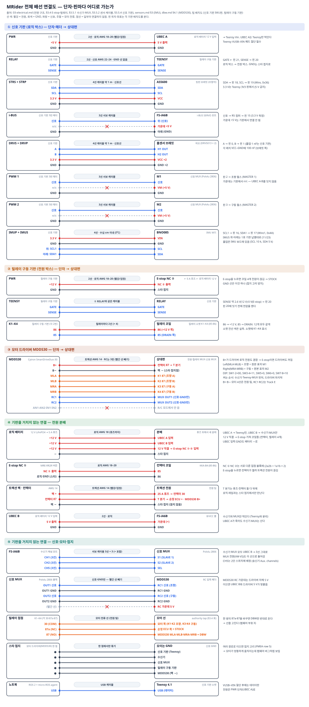

# 전체 배선 연결도 — 단자마다 어디로 가는가

신호 기판과 릴레이 구동 기판의 단자·헤더, 모터 드라이버(MDDS30) 단자, 그리고 기판을 거치지 않는 선까지 **핀 하나하나가 어느 장치의 어느 핀으로 가는지** 한곳에 모았다.
차에 선을 깔 때와 통전 검사를 할 때 이 문서 하나를 옆에 두고 쓴다.

- **대상 독자:** 기판을 다 만들고 차에 배선하는 사람
- **원본(기준):** `docs/build/03-electrical.md`
  - 전원 구조: 맨 앞의 전원 트리와 레일 표
  - §3.4: E-stop·컨택터·릴레이 MUX, K1–K4 표, 코일 극성
  - §3.5.1: 수신기·신호 MUX, 빨간 선 빼기, 스타 접지
  - §3.5.2: 센서 케이블, 풀업·1 nF·100 nF 위치
  - §3.5.4: 신호 기판 단자, "Where it all sits on the board"(릴레이 구동 기판)
  - §3.5: MDDS30 입력 모드 표(R/C 모드, `RC1`·`RC2`만 사용)
- **MDDS30:** `docs/design/dbw.md` §4.1 (Left = 조향, Right = 구동, DIP 스위치, 켜는 순서)
- **IMU:** `docs/design/sensors.md` §3 (Wire1, SDA1 17·SCL1 16)
- **기판 안쪽(구멍 좌표·납땜):**
  - [신호 기판 가이드](../01_firmware/03_signal_board_guide.md)
  - [릴레이 구동 기판 가이드](../03_relay_board/01_relay_board_guide.md)
- **전체 구조 그림(원본):**
  - [로직·신호 배선](../../images/logic-signal-wiring.svg)
  - [전원 배선](../../images/power-wiring.svg)
  - 이 문서는 그 그림을 **핀 단위로 풀어 쓴 것**이다. 원본과 다르면 원본이 맞다.

---

## 1. 그림 읽는 법

그림 생성: `docs/02_guide/02_power_wire/images/gen_system_wiring.py` (사용법은 파일 맨 위)

- **왼쪽 상자 = 출발**(기판의 단자·헤더), **오른쪽 상자 = 도착**(상대 장치의 핀)이다. 같은 높이의 핀끼리 선 하나로 잇는다.
- **선 색**
  - 빨강: 전원
  - 회색: GND
  - 파랑: 신호
  - 주황: 모터 전류 (MDDS30 출력 ↔ 릴레이 접점 ↔ 모터)
- **점선 + ✕:** 일부러 잇지 않는 핀이다. 빠뜨린 것이 아니다. 이유는 §3에 있다.
- **가운데 둥근 상자:** 쓰는 선의 종류와 굵기(`docs/build/01-bom-sourcing.md` #12).
  - 트랙션: AWG 14
  - 로직: AWG 18–20, 빨강·검정
  - 신호: AWG 22–24, 빨강·검정이 아닌 색
- **오른쪽 글:** 그 연결에서 틀리기 쉬운 점이다.

## 2. 연결표

그림과 같은 데이터다. `python3 docs/02_guide/02_power_wire/images/gen_system_wiring.py --table`로 다시 뽑는다.
연결을 바꿀 때는 생성기의 `SECTIONS`를 고친 뒤 그림과 이 표를 둘 다 다시 만든다.

#### ① 신호 기판 (로직 박스) — 단자·헤더 → 상대편

| 출발 | 도착 | 핀 대응 (출발 → 도착) | 선 |
|---|---|---|---|
| **PWR** (신호 기판) | **UBEC A** (로직 배터리 12 V 입력) | +5 V → 5 V 출력 GND → GND | 2선 · 로직 AWG 18–20 (빨강/검정) |
| **RELAY** (신호 기판) | **TEENSY** (릴레이 구동 기판) | GATE → GATE SENSE → SENSE | 2선 · 신호 AWG 22–24 · GND 선 없음 |
| **STRS + STRP** (신호 기판) | **AS5600** (킹핀 브래킷 (조향각)) | SDA → SDA SCL → SCL 3.3 V → VCC GND → GND | 4선 케이블 약 1 m · 신호선 |
| **i-BUS** (신호 기판 3핀 헤더) | **FS-iA6B** (i-BUS SERVO 포트) | 신호 → 위 (신호) n/c ✕ 가운데 +5 V (잇지 않음) GND → 아래 (GND) | 3선 서보 케이블 |
| **DRVS + DRVP** (신호 기판) | **홀센서 브래킷** (허브 (DRV5013 × 2)) | A → H1 OUT B → H2 OUT 3.3 V → VCC ×2 GND → GND ×2 | 4선 케이블 약 1 m · 신호선 |
| **PWM 1** (신호 기판 3핀 헤더) | **M1** (신호 MUX (Pololu 2806)) | 신호 → 신호 n/c ✕ VM (+5 V) (잇지 않음) GND → GND | 3선 서보 케이블 |
| **PWM 2** (신호 기판 3핀 헤더) | **M2** (신호 MUX (Pololu 2806)) | 신호 → 신호 n/c ✕ VM (+5 V) (잇지 않음) GND → GND | 3선 서보 케이블 |
| **IMUP + IMUS** (신호 기판) | **BNO085** (IMU 보드) | 3.3 V → VIN GND → GND 위: SCL1 → SCL 아래: SDA1 → SDA | 4선 · 수십 cm 이내 (I²C) |

#### ② 릴레이 구동 기판 (전원 박스) — 단자 → 상대편

| 출발 | 도착 | 핀 대응 (출발 → 도착) | 선 |
|---|---|---|---|
| **PWR** (릴레이 구동 기판) | **E-stop NC ②** (← 5 A 퓨즈 ← 로직 배터리 12 V) | +12 V → NC ② 출력 GND → 스타 접지 | 2선 · 로직 AWG 18–20 (빨강/검정) |
| **TEENSY** (릴레이 구동 기판) | **RELAY** (신호 기판) | GATE → GATE SENSE → SENSE | ① RELAY와 같은 케이블 |
| **K1–K4** (릴레이 구동 기판 (각 2핀)) | **릴레이 코일** (릴레이 소켓 K1–K4 (85·86)) | 86 → 86 (+12 V 쪽) 85 → 85 (DRAIN 쪽) | 릴레이마다 2선 (× 4) |

#### ③ 모터 드라이버 MDDS30 — 단자 → 상대편

| 출발 | 도착 | 핀 대응 (출발 → 도착) | 선 |
|---|---|---|---|
| **MDDS30** (Cytron SmartDriveDuo-30) | **상대편** (전원·릴레이 MUX·신호 MUX) | B+ → 컨택터 87 → T 분기 B− → 팩 − (스타 접지점) MLA → K1 87 (조향 A) MLB → K2 87 (조향 B) MRA → K3 87 (구동 A) MRB → K4 87 (구동 B) RC1 → MUX OUT1 (신호·GND만) RC2 → MUX OUT2 (신호·GND만) AN1·AN2·IN1·IN2 ✕ R/C 모드에서 안 씀 (잇지 않음) | 트랙션 AWG 14 · RC는 3핀 (빨간 선 빼기) |

#### ④ 기판을 거치지 않는 연결 — 전원 분배

| 출발 | 도착 | 핀 대응 (출발 → 도착) | 선 |
|---|---|---|---|
| **로직 배터리** (12 V LiFePO4 → 5 A 퓨즈) | **분배** (퓨즈 뒤에서 세 갈래) | +12 V → UBEC A 입력 +12 V → UBEC B 입력 +12 V → 12 V 직결 → E-stop NC ①·② 입력 − → 스타 접지 | 로직 AWG 18 (퓨즈까지) |
| **E-stop NC ①** (MRE-RR2R 버튼) | **컨택터 코일** (KKA-B4 (85·86)) | NC ① 출력 → 85 로직 GND (스타) → 86 | 로직 AWG 18–20 |
| **트랙션 팩 · 컨택터** (AWG 14) | **트랙션 전원** (전원 팀) | 팩 + → 25 A 퓨즈 → 컨택터 30 컨택터 87 → T 분기 → 순정 ECU + · MDDS30 B+ 팩 − → 스타 접지 (끊지 않음) | 트랙션 AWG 14 (빨강/검정) |
| **UBEC B** (로직 배터리 12 V 입력) | **FS-iA6B** (B/VCC 줄) | 5 V 출력 → 가운데 (+) GND → GND | 2선 · 로직 |

#### ⑤ 기판을 거치지 않는 연결 — 신호·모터·접지

| 출발 | 도착 | 핀 대응 (출발 → 도착) | 선 |
|---|---|---|---|
| **FS-iA6B** (수신기 채널 포트) | **신호 MUX** (Pololu 2806) | CH1 (3선) → S1 (SLAVE 1) CH2 (3선) → S2 (SLAVE 2) CH5 (3선) → SEL | 서보 케이블 3선 × 3 (+ 포함) |
| **신호 MUX** (Pololu 2806 출력) | **MDDS30** (RC 입력 헤더) | OUT1 신호 → RC1 신호 (조향) OUT1 GND → RC1 GND OUT2 신호 → RC2 신호 (구동) OUT2 GND → RC2 GND (빨간 선) ✕ RC 가운데 5 V (잇지 않음) | 신호·GND만 — 빨간 선 빼기 |
| **릴레이 접점** (K1–K4 (각 30·87a·87)) | **모터 선** (authority tap (§3.4 표)) | 30 (COM) → 모터 쪽 (K1·K2 조향, K3·K4 구동) 87a (NC) → 순정 ECU 쪽 = STOCK 87 (NO) → MDDS30 MLA·MLB·MRA·MRB = DBW | 모터 전류 선 (전원 팀) |
| **스타 접지** (모터 드라이버(MDDS30) 한 점) | **모이는 GND** (신호 GND) | ● → 신호 기판 (Teensy) ● → 수신기 ● → 신호 MUX ● → 릴레이 구동 기판 ● → MDDS30 (팩 −) | 한 점에서만 묶기 |
| **노트북** (ROS 2 + micro-ROS agent) | **Teensy 4.1** (신호 기판 소켓) | USB → USB (데이터) | USB 케이블 |

- **K1–K4 개별 배정**(`docs/build/03-electrical.md` §3.4 표)

  | 릴레이 | 끊는 선 | 30 (COM) | 87a (STOCK) | 87 (DBW) |
  |---|---|---|---|---|
  | K1 | 조향 A | 조향 모터 A | 순정 ECU 조향 A | MDDS30 `MLA` (원본 표의 `M1` A) |
  | K2 | 조향 B | 조향 모터 B | 순정 ECU 조향 B | MDDS30 `MLB` (`M1` B) |
  | K3 | 구동 A | 구동 모터 A (병렬) | 순정 ECU 구동 A | MDDS30 `MRA` (`M2` A) |
  | K4 | 구동 B | 구동 모터 B (병렬) | 순정 ECU 구동 B | MDDS30 `MRB` (`M2` B) |

  - 원본 §3.4 표는 드라이버 출력을 `M1`·`M2`로 부른다. MDDS30에는 `Left`·`Right`로 인쇄되어 있다.
    `M1` = Left = 조향, `M2` = Right = 구동이다(`docs/design/dbw.md` §4.1).
  - A·B 글자 자체보다 짝이 중요하다. 한 쌍 안에서 `87a`(순정 ECU)와 `87`(드라이버)의 A·B 순서가 같아야 한다.

## 3. 일부러 잇지 않는 핀과 그 이유

같은 모양의 3핀 커넥터라도 **가운데(+5 V)는 대부분 잇지 않는다.** 서로 다른 전원끼리 출력이 맞붙지 않게 하려는 것이다.

| 어디 | 잇지 않는 것 | 이으면 생기는 일 | 출처 |
|---|---|---|---|
| 신호 기판 i-BUS 헤더 | 수신기 SERVO 가운데 +5 V | 수신기 전원(UBEC B)이 Teensy 쪽으로 들어온다 | §3.5.4 |
| 신호 기판 PWM 1·2 헤더 | MUX M1·M2 가운데(VM) | UBEC A와 UBEC B가 출력끼리 이어진다 | §3.5.4 |
| MUX OUT → MDDS30 RC | 빨간 선(가운데) | MDDS30 자체 5 V(트랙션 팩)와 UBEC B(로직 배터리)가 맞붙는다. 한쪽 끝에서 핀을 빼고 테이프로 감는다 | §3.5.1 |
| 신호 기판 ↔ 릴레이 구동 기판 | GND 선 | 두 기판 GND가 이미 스타 접지에서 만난다. 하나 더 이으면 접지 고리 | "Where it all sits on the board" |
| Teensy VUSB–VIN | 패드를 자른다 | USB 5 V와 UBEC A가 맞붙는다. 자른 뒤에는 USB만으로 Teensy가 켜지지 않는다 | `docs/build/04-firmware.md` |

## 4. 배선 순서

1. **전원을 모두 끈다.** 로직 배터리와 트랙션 팩을 뺀다. 선은 꺼진 상태에서만 바꾼다.
2. **트랙션 줄** (전원 팀): 팩 + → 25 A 퓨즈 → 컨택터 30, 87 → T 분기 → 순정 ECU +·MDDS30 `B+`, 팩 − → MDDS30 `B−`(스타).
3. **로직 줄:** 로직 배터리 → 5 A 퓨즈 → UBEC A·UBEC B·12 V 직결. 배터리 −는 스타로.
4. **E-stop:**
   - 12 V 직결을 NC ①·NC ② 입력으로 잇는다.
   - NC ① 출력은 컨택터 85로, 컨택터 86은 로직 GND로 잇는다.
   - NC ② 출력은 릴레이 구동 기판 PWR +12 V로 잇는다.
   - **NC ①과 NC ②는 서로 다른 접점 블록에서 가져온다.** 2a2b는 1a1b 블록 두 개다.
5. **릴레이 코일:**
   - 릴레이 구동 기판 K1–K4를 소켓의 85·86에 잇는다.
   - 12개 모두 **86 → +12 V 쪽, 85 → DRAIN 쪽**으로 같게 잇는다.
   - 소켓 전선 색은 정해져 있지 않으니 미터로 재서 확인한다.
6. **MDDS30과 릴레이 접점** (모터 선, 전원 팀):
   - **잇기 전에 MDDS30 DIP을 맞춘다:** `SW1·2 = 00`(R/C), `SW3·4 = 11`(채널 독립), `SW5 = 0`, `SW6 = 0`, `SW7·8 = 10`(납축).
     출고 상태는 모두 0인데, `SW3·4 = 00`은 MIXED라서 스로틀 명령이 조향 모터를 돌린다(`docs/design/dbw.md` §4.1).
   - `MLA` → K1 `87`, `MLB` → K2 `87`, `MRA` → K3 `87`, `MRB` → K4 `87`. 나머지 접점은 K1–K4 표대로 잇는다.
   - 한 쌍 안에서 87a·87을 바꾸면 STOCK은 멀쩡하고 DBW만 반대로 돈다.
   - `AN1`·`AN2`·`IN1`·`IN2`는 다른 모드용이라 비워 둔다.
7. **수신기·MUX:**
   - UBEC B를 수신기 B/VCC 줄에 잇는다.
   - 수신기 CH1·CH2·CH5를 MUX S1·S2·SEL에 3선 그대로 잇는다.
   - MUX OUT1·OUT2를 MDDS30 RC1·RC2에 신호·GND만 잇는다. 빨간 선은 뺀다.
8. **신호 기판:**
   - PWR을 UBEC A에, PWM 1·2를 MUX M1·M2에, i-BUS를 수신기 SERVO에 잇는다.
   - 그다음 AS5600, 홀센서, IMU를 잇는다.
9. **두 기판 사이:**
   - 신호 기판 RELAY와 릴레이 구동 기판 TEENSY를 GATE·SENSE 2선으로 잇는다.
   - 그 전에 릴레이 구동 기판 SENSE 전압을 재서 약 2.6 V인지 확인한다(아래 §5).
10. **스타 접지:**
    - 신호 GND를 모두 MDDS30 한 점으로 모은다. 대상은 신호 기판, 수신기, MUX, 릴레이 구동 기판, 팩 −다.
    - 차체 나사에 따로 묶지 않는다.

## 5. 전원 넣기 전·후 검사

- **전원 넣기 전** (`docs/build/03-electrical.md` §3.6, 멀티미터 통전 모드)
  - 트랙션 레일과 로직 레일 사이에 통전이 없어야 한다(스타 접지 한 점은 예외).
  - MDDS30 Left 출력(`MLA`·`MLB`)과 Right 출력(`MRA`·`MRB`) 사이에 통전이 없어야 한다(원본의 "M1과 M2").
  - 코일이 꺼진 상태에서 릴레이 NC 접점은 순정 ECU와 모터를 잇는다.
  - 위 §3의 "잇지 않는 핀"이 정말 비어 있는지 본다. 3핀 커넥터 가운데 핀이 대상이다.
- **로직 전원만 넣고**
  - 릴레이 구동 기판 SENSE에서 약 2.6 V가 나오는지 본다. E-stop을 누르면 0 V여야 한다. 3.3 V를 넘으면 핀 20에 잇지 않는다.
    방법은 [릴레이 구동 기판 검증](../../03_validation/03_relay_board/01_relay_board.md)에 있다.
  - 신호 기판 PWR이 5 V인지, Teensy 3V3 핀이 3.3 V인지 잰다.
  - 센서는 bench 스케치로 확인한다(`i2c_scan`, `as5600_check`, `quad_count`, `ibus_monitor`, `imu_check`).
    결과는 [Stage 0 테스트 벤치 검증](../../03_validation/01_firmware/test_bench.md)과
    [조향 단계 벤치 검증](../../03_validation/01_firmware/02_steering_bench.md)에 적는다.
- **트랙션 전원을 넣을 때: 드라이버를 마지막에 켠다.**
  - MDDS30은 `SW6 = 0`에서 켜지는 순간 `RC1`·`RC2`에 들어온 펄스를 "정지"로 기억한다(`docs/design/dbw.md` §4.1).
  - 그래서 수신기, Teensy, MUX를 먼저 켜서 1500 µs가 나오는 상태를 만든 뒤 컨택터(드라이버)를 켠다.
  - `B+`가 드라이버 로직 전원도 겸하므로, E-stop을 풀 때도 드라이버가 새로 켜지는 것과 같다.
- **릴레이 MUX:** `docs/build/03-electrical.md` §3.7 절차대로 확인한다. Teensy를 일부러 멈춘 상태에서도 STOCK으로 돌아가는지 본다.

## 6. 막혔을 때

| 증상 | 먼저 볼 곳 |
|---|---|
| 모터가 가끔 혼자 움찔하고, 펌웨어 버그처럼 보인다 | GND가 스타 한 점 말고 다른 경로로도 이어졌는지(접지 고리, FMEA row 5) |
| STOCK은 정상인데 DBW에서 조향이 반대로 돈다 | K1·K2 (또는 K3·K4) 한 쌍의 87a·87이 뒤바뀌었는지. 펌웨어 부호로 고치지 않는다 |
| 스로틀 스틱이 조향 모터를 돌린다 | MDDS30 `SW3·4`가 `00`(MIXED)인지. `11`로 바꾼다 |
| 정지 명령인데 모터가 천천히 돈다 | 드라이버가 먼저 켜져 엉뚱한 펄스를 정지로 기억했는지(`SW6 = 0`). 수신기·Teensy·MUX를 켠 뒤 드라이버를 다시 켠다 |
| E-stop을 눌러도 릴레이가 STOCK으로 안 돌아온다 | 릴레이 구동 기판 PWR +12 V가 NC ② 출력이 아니라 12 V 직결에 물렸는지 |
| E-stop을 눌러도 바퀴가 돈다 | 컨택터 85가 NC ① 출력에 물렸는지, NC ①·② 중 하나가 NO(a접점)에 물렸는지 |
| IMU가 Wire1 스캔에 안 보인다 | IMUS 위·아래 표기(1호 기판은 위 = SCL1 → 핀 16, 아래 = SDA1 → 핀 17)와 IMU 보드 SDA·SCL이 맞는지 |
| USB를 꽂아도 Teensy가 안 켜진다 | 정상이다(VUSB–VIN 절단 후). PWR 단자에 UBEC A 5 V를 넣는다 |
