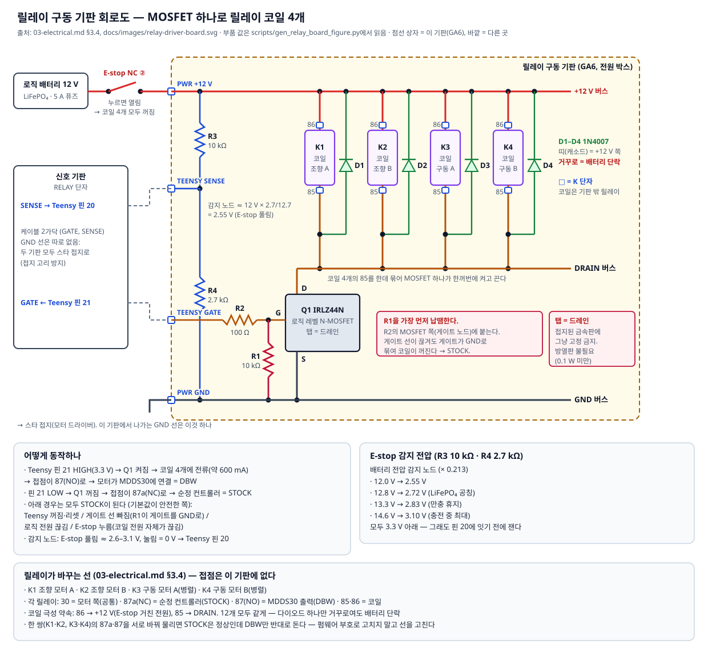
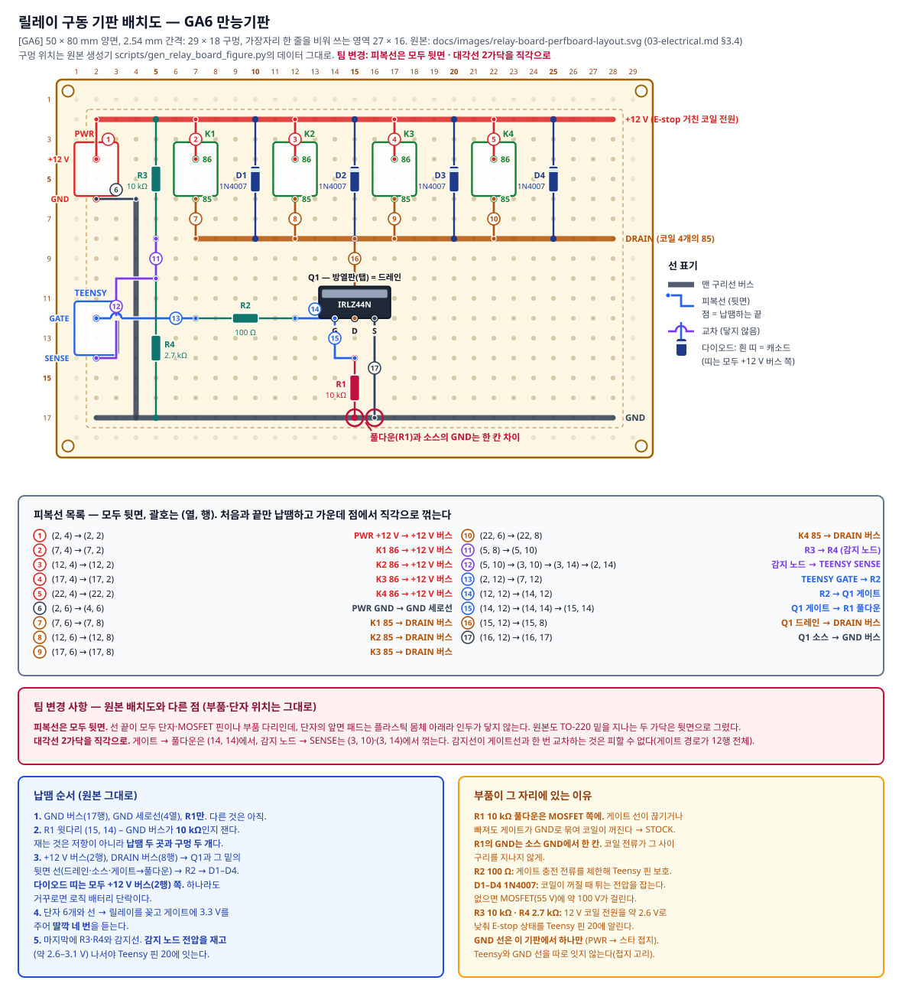

# 릴레이 구동 기판 가이드 — 만들고 확인하기

직사각형 만능기판(GA6 50 × 80, 29 × 18 구멍)에 릴레이 구동 기판을 만드는 방법. 단계마다 무엇을 달고 무엇을 재는지 적었다.

- **대상 독자:** 이 기판을 처음 만드는 사람
- **설계와 결정 이유:** [릴레이 구동 기판 설계](../../01_development/03_relay_board/01_relay_board_design.md) (연결표, 원칙의 이유, 원본과 다른 점)
- **검사 기록:** [릴레이 구동 기판 검증](../../03_validation/03_relay_board/01_relay_board.md)
- **원본:** `docs/build/03-electrical.md` §3.4, "Where it all sits on the board", §3.7

---

## 1. 이 기판이 하는 일

그림 생성: `docs/02_guide/03_relay_board/images/gen_relay_board_schematic.py` (사용법은 파일 맨 위)

- **릴레이:** 코일에 전류가 흐르면 안의 스위치(접점)가 넘어가는 부품이다. 코일 단자는 `85`·`86`이고, 접점은 `30`(공통),
  `87a`(평소 붙어 있음, NC), `87`(코일이 켜질 때 붙음, NO)이다. 이 기판은 **코일만** 다룬다.
- **MOSFET(Q1):** 게이트에 3.3 V가 걸리면 드레인–소스가 이어지는 전자 스위치다. 코일 4개의 `85`를 GND 쪽에서 한꺼번에 끊고 잇는다(로우사이드 스위치).
- **풀다운(R1):** 아무도 게이트를 잡고 있지 않을 때 게이트를 GND로 끌어 MOSFET을 확실히 끈다. 이 기판의 안전은 이 저항 하나에 걸려 있다.
- **플라이백 다이오드(D1–D4):** 코일은 전류가 갑자기 끊기면 큰 전압을 만든다. 다이오드가 그 전류를 코일로 되돌려 MOSFET을 지킨다.
- **분압기(R3·R4):** 12 V를 약 2.6 V로 낮춰 Teensy가 "E-stop이 풀려 있다"를 읽게 한다. Teensy 핀은 3.3 V까지만 견딘다.
- **결과:** Teensy 핀 21이 HIGH면 DBW, LOW이거나 선이 빠지거나 E-stop을 누르면 STOCK이다.

## 2. 배치도 읽는 법

그림 생성: `docs/02_guide/03_relay_board/images/gen_relay_board_layout.py` (원본 생성기의 구멍 데이터를 그대로 읽는다)

- **좌표 (열, 행):** 그림 위쪽 숫자가 열(1–29), 왼쪽 숫자가 행(1–18)이다. 가장자리 한 줄은 비워 둔다.
- **면:** 부품과 단자는 **앞면**, 버스(맨 구리선)와 피복선은 **뒷면**(납땜면)에 둔다.
  뒤집으면 **좌우(열 번호)가 반대**로 보이니 가장자리에 5열마다 번호를 적어 두면 좋다.
- **다이오드:** 몸통의 흰 띠가 캐소드다. **띠는 모두 2행(+12 V 버스) 쪽**이다.
- **Q1(IRLZ44N):** 세워서 꽂는다. **글자 면이 아래(GND 버스 쪽), 금속 탭이 위(DRAIN 버스 쪽)** 를 보면 왼쪽부터 G(14, 12) · D(15, 12) · S(16, 12)다.
- **단자대:** 두 핀이 세로로 서는 원본 방향 그대로다. 헤더를 납땜하기 전에 플러그를 꽂아 보고 **전선 구멍 방향**을 확인한다.
  PWR·TEENSY는 왼쪽 가장자리를 향하게, K1–K4는 모두 같은 쪽을 향하게 맞춘다.

## 3. 준비물

| 부품 | 수량 | 위치 |
|---|---|---|
| GA6 만능기판 50 × 80 | 1 | — |
| `IRLZ44N` (TO-220) | 1 | Q1 — **정전기에 약하다.** 만지기 전에 접지된 금속을 만진다 |
| 10 kΩ | 2 | R1 (15, 14)–(15, 17) 풀다운, R3 (5, 2)–(5, 8) |
| 100 Ω | 1 | R2 (7, 12)–(12, 12) |
| 2.7 kΩ | 1 | R4 (5, 10)–(5, 17) |
| `1N4007` | 4 | D1 (10, 2)–(10, 8), D2 (15, …), D3 (20, …), D4 (25, …) |
| 2단자 플러그형 단자대 (5.08 mm) | 6 | PWR, TEENSY, K1–K4 |
| 맨 구리선 (AWG 22 단선), 피복 단선 (AWG 22–24) | 적당량 | 버스 / 피복선 |

부품 출처: `docs/order-log.md` #7(MOSFET, 저항 키트, 다이오드, 릴레이·소켓), #12b(기판, 단자대). 공구: 인두, 니퍼, 멀티미터(도통·저항·다이오드 모드), 12 V 벤치 전원(전류 제한).

## 4. 납땜 순서 — 단계마다 재고 넘어간다

이 기판은 벤치 버전이 없어서 **처음 만든 것이 최종본**이다. 한 단계를 끝낼 때마다 재고, 값이 맞을 때만 다음 단계로 간다.
아래 "검증 N"은 [검증 문서](../../03_validation/03_relay_board/01_relay_board.md)의 항목 번호다.

### 4.1 GND와 풀다운만 (원본 1단계)

1. **GND 버스:** 17행, 2–28열을 맨 구리선 한 가닥으로 잇는다.
2. **GND 세로선:** 4열, 6–17행.
3. **R1 10 kΩ:** (15, 14)–(15, 17). **다른 부품은 아직 달지 않는다.**
4. **잰다 (검증 1):** R1 윗다리 (15, 14) ↔ GND 버스 = **10 kΩ**.
   이 측정은 저항값이 아니라 **납땜 두 곳과 구멍 두 개**를 확인하는 것이다. 다른 것이 없으니 값이 틀리면 원인은 그 납땜뿐이다.

### 4.2 나머지 버스

1. **+12 V 버스:** 2행, 2–28열.
2. **DRAIN 버스:** 8행, 7–28열.
3. **잰다 (검증 2):** +12 V ↔ GND, DRAIN ↔ GND, +12 V ↔ DRAIN 모두 **열림**.

### 4.3 Q1, R2, 다이오드 (원본 3단계)

1. **Q1:** 글자 면을 아래로 세워 G(14, 12) · D(15, 12) · S(16, 12)에 꽂는다. 금속 탭을 접지된 판에 고정하지 않는다(탭 = 드레인).
2. **Q1의 뒷면 선:** 16번 드레인 → DRAIN 버스, 17번 소스 → GND 버스, 15번 게이트 → R1 (배선표 참고).
3. **R2 100 Ω:** (7, 12)–(12, 12), 14번 선 (12, 12) → (14, 12).
4. **D1–D4:** **띠를 2행(+12 V)** 쪽으로 꽂는다.
5. **잰다 (검증 3):**
   - 게이트 (14, 12) ↔ GND = 여전히 **10 kΩ**
   - 다이오드 모드: 빨강 DRAIN, 검정 +12 V → **약 0.5 V**. 거꾸로(빨강 +12 V, 검정 DRAIN) → **OL**.
     거꾸로 쟀는데 0.5 V 근처가 나오면 **다이오드 하나가 반대로** 꽂힌 것이다. 전원을 넣기 전에 반드시 고친다.

### 4.4 단자와 선, 첫 전원 (원본 4단계)

1. **단자대 6개:** PWR (2, 4)·(2, 6), TEENSY (2, 12)·(2, 14), K1–K4 (7·12·17·22, 4)·(…, 6).
2. **피복선:** 아래 배선표의 1–10번, 13번.
3. **잰다 (검증 4):** 단자 ↔ 버스 도통 (PWR +12 V ↔ +12 V 버스, PWR GND ↔ GND, 각 K의 86 ↔ +12 V, 85 ↔ DRAIN, GATE ↔ R2 왼쪽).
4. **첫 전원 (검증 5):**
   - 벤치 전원을 **12 V, 전류 제한 1 A**로 맞춰 PWR에 연결하고, 릴레이 코일을 K1–K4에 연결한다(86·85).
   - **GATE에 아무것도 연결하지 않음** → 딸깍 없음, 전류 수 mA (STOCK)
   - **GATE에 3.3 V** (같은 GND 기준) → **딸깍 네 번**, 전류 약 600 mA (DBW)
   - 3.3 V를 떼면 다시 딸깍 → STOCK

### 4.5 E-stop 감지 (원본 5단계)

1. **R3 10 kΩ** (5, 2)–(5, 8), **R4 2.7 kΩ** (5, 10)–(5, 17), 11번 선 (5, 8) → (5, 10), 12번 선 감지 노드 → SENSE.
2. **잰다 (검증 6):** 12 V를 넣고 TEENSY SENSE ↔ GND = **약 2.55 V**(배터리 12.0 V 기준, 14.6 V에서도 3.1 V).
   12 V를 빼면 0 V. **이 값을 확인하기 전에는 SENSE 선을 Teensy에 잇지 않는다.**

### 배선표 — 피복선 17가닥, 모두 뒷면

| # | 경로 (꺾는 점) | 역할 |
|---|---|---|
| 1 | (2, 4) → (2, 2) | PWR +12 V → +12 V 버스 |
| 2 | (7, 4) → (7, 2) | K1 86 → +12 V 버스 |
| 3 | (12, 4) → (12, 2) | K2 86 → +12 V 버스 |
| 4 | (17, 4) → (17, 2) | K3 86 → +12 V 버스 |
| 5 | (22, 4) → (22, 2) | K4 86 → +12 V 버스 |
| 6 | (2, 6) → (4, 6) | PWR GND → GND 세로선 |
| 7 | (7, 6) → (7, 8) | K1 85 → DRAIN 버스 |
| 8 | (12, 6) → (12, 8) | K2 85 → DRAIN 버스 |
| 9 | (17, 6) → (17, 8) | K3 85 → DRAIN 버스 |
| 10 | (22, 6) → (22, 8) | K4 85 → DRAIN 버스 |
| 11 | (5, 8) → (5, 10) | R3 → R4 (감지 노드) |
| 12 | (5, 10) → (3, 10) → (3, 14) → (2, 14) | 감지 노드 → TEENSY SENSE |
| 13 | (2, 12) → (7, 12) | TEENSY GATE → R2 |
| 14 | (12, 12) → (14, 12) | R2 → Q1 게이트 |
| 15 | (14, 12) → (14, 14) → (15, 14) | Q1 게이트 → R1 풀다운 |
| 16 | (15, 12) → (15, 8) | Q1 드레인 → DRAIN 버스 |
| 17 | (16, 12) → (16, 17) | Q1 소스 → GND 버스 |

- 연결(어느 구멍과 어느 구멍)은 원본 생성기의 `JUMPERS`와 같다. 12·15번만 직각 경로를 팀 생성기가 정했다.
- 12번(감지선)은 (3, 12)에서 13번(게이트선)과 교차한다. 피복선끼리 겹쳐 지나가는 것은 괜찮다.

## 5. 신호 기판과 연결

| 릴레이 구동 기판 `TEENSY` | 케이블 | 신호 기판 `RELAY` |
|---|---|---|
| GATE (2, 12) | 1가닥 | GATE → Teensy 핀 21 |
| SENSE (2, 14) | 1가닥 | SENSE → Teensy 핀 20 |

- **GND 선은 잇지 않는다.** 두 기판 모두 스타 접지(모터 드라이버)로 GND가 모이므로, 선을 더하면 접지 고리가 생긴다.
- 연결 후 `estop_relay_check` 스케치로 확인한다(검증 7). `cd firmware/bench` 후 `pio run -e estop_relay_check -t upload`, `pio device monitor -p /dev/ttyACM0`.
  - 업로드 직후에는 Teensy가 재부팅 중이라 포트가 잠깐 없다. 모니터가 포트를 물어보면 `Ctrl+C`로 나와 2–3초 뒤 다시 연다.
  - 시리얼 모니터에서 `g` → 게이트 HIGH(DBW, E-stop이 풀려 있을 때만), `x` → LOW(STOCK).
  - E-stop을 누르면 감지가 LOW가 되고, 코일이 하드웨어로 꺼진다.

## 6. 기판 밖: 릴레이와 소켓

- K 단자의 86·85를 각 릴레이 소켓의 코일 선에 잇는다. **86 → +12 V 쪽, 85 → DRAIN 쪽**을 12개 모두 같게 지킨다.
- 소켓 전선 색은 제조사마다 다르다. **멀티미터로 85·86·30·87·87a를 확인**하고, 소켓에 K1–K4를 매직으로 적는다.
- 접점(30·87·87a)은 이 기판과 상관없이 모터 선을 바꾼다. 어떤 릴레이가 어떤 선을 바꾸는지는 `03-electrical.md` §3.4 표를 따른다.
  한 쌍의 87a·87을 바꿔 물리면 STOCK은 정상이고 DBW만 반대로 돈다. 그러면 **선을 고친다**(펌웨어 부호로 고치지 않는다).
- 접점 쪽 배선과 §3.7 벤치 시험은 전원 팀과 함께 한다.

## 7. 막혔을 때

| 증상 | 원인 | 조치 |
|---|---|---|
| 4.1에서 10 kΩ이 아님 | R1 납땜, R1 다리가 GND 버스 구멍에 안 붙음 | 그 두 납땜만 다시 |
| 전원을 넣자마자 전류 제한에 걸림 | 다이오드가 거꾸로, +12 V와 GND가 붙음 | 바로 끄고 검증 3의 다이오드 측정 |
| GATE에 아무것도 안 했는데 딸깍거림 | 게이트가 뜸: R1이 안 붙었거나 15번 선 불량 | 게이트 ↔ GND 10 kΩ 다시 잰다 |
| 3.3 V를 줘도 딸깍 없음 | GATE와 3.3 V의 GND가 다름, R2·14번 선 불량, Q1 방향 | 같은 GND인지, 게이트 (14, 12)에 3.3 V가 오는지 잰다 |
| 일부 릴레이만 딸깍 | 그 K 단자의 86·85 선, 릴레이 소켓 배선 | 그 코일 단자에서 12 V가 오가는지 잰다 |
| SENSE가 0 V | R3·R4·11번·12번 선, 12 V가 안 들어옴 | 감지 노드 (5, 10) 전압부터 |
| SENSE가 3.3 V보다 높음 | R3·R4가 바뀜(2.7 kΩ이 위에) | **Teensy에 잇지 말고** 저항 위치를 확인 |
